# 🌾 Beam Farm 3D — โครงสร้างโปรเจกต์ สถาปัตยกรรม การเชื่อมต่อโมดูล และ Dependencies (ฉบับสมบูรณ์)

เอกสารฉบับนี้จัดทำขึ้นเพื่อแจกแจงโครงสร้างระบบ, สถาปัตยกรรมการทำงาน, ความสัมพันธ์ของการเชื่อมต่อ (Interconnections & Data Pipelines) และ **การแยกหน้าที่ของโค้ดอย่างละเอียด (Separation of Concerns: หน้าที่ของใครของมัน)** โดยเฉพาะใน 3 ส่วนแกนหลักตามที่ระบุ:
1. **`src/components/3d/FarmHouses.ts`** (และโมดูลย่อยใน `src/components/3d/structures/*`)
2. **`src/types/*`** (การแยกสัญญาข้อมูล Data Contracts ออกเป็นโมดูลย่อยตามโดเมนหน้าที่ + Barrel Export)
3. **`src/fishing`** (สถาปัตยกรรมเอนจินตกปลา 3 มิติเต็มรูปแบบ / Standalone Subsystem)

---

## 1. 📦 ภาพรวม Dependencies ทั้งหมด

### 1.1 Runtime Dependencies (`package.json`)
| แพ็กเกจ | เวอร์ชัน | หน้าที่และความรับผิดชอบในระบบ |
| :--- | :--- | :--- |
| **`react`** / **`react-dom`** | `^19.3.1` | ควบคุม Component Tree, React Hooks จัดการ State ทั่วโลก (`useFarmEconomy`, `useFarmPlots`, `useFarmPlacement`, `useFarmWorldHandlers`) และประสานงาน UI Modals/HUD |
| **`three`** | `^0.186.1` | เอนจินกราฟิก WebGL2 3D หลัก ทำหน้าที่ Render กราฟิกฉากฟาร์ม, ภูมิประเทศ, InstancedMesh หญ้าพลิ้ว, แปลงผัก, ต้นไม้, สัตว์ 3D, อาคาร, ตัวละคร และฉากจำลองตกปลา 3D |
| **`lucide-react`** | `^0.546.0` | ชุด SVG Vector Icons ประสิทธิภาพสูง ไม่สร้างภาระโหลด DOM ใช้ในแถบเมนู, ปุ่มควบคุม, และหน้าต่าง Modal ทุกบาน |
| **`motion`** | `^12.43.0` | จัดการ UI Animation และ Transition นอก Canvas 3D |
| **`@capacitor/core`** | `^8.6.0` | รันไทม์บริดจ์สำหรับห่อหุ้มเว็บแอปพลิเคชันเป็น Android Native APK (`capacitor.config.ts`) |
| **`express`** / **`dotenv`** | `^4.22.3` / `^17.4.2` | โครงสร้าง Server-side และการจัดการ Environment Variables ตามมาตรฐานระบบ Node.js |

### 1.2 Development & Build Dependencies (`devDependencies`)
| แพ็กเกจ | เวอร์ชัน | หน้าที่ในระบบ Build & Tooling |
| :--- | :--- | :--- |
| **`vite`** + **`@vitejs/plugin-react`** | `^8.3.5` / `^6.1.2` | บิลด์ทูลความเร็วสูง สำหรับ Dev Server (Port `3000`) และ Rollup Production Bundler |
| **`tailwindcss`** + **`@tailwindcss/vite`** | `^4.3.3` | เอนจิน Tailwind CSS v4 สำหรับจัดสไตล์ UI บนหน้าจอ ผ่าน `@import "tailwindcss";` ใน `src/index.css` |
| **`vite-plugin-pwa`** | `^2.0.0` | จัดการ Web App Manifest, Service Worker (Workbox) และออฟไลน์แคชชิ่งสำหรับ Assets & GLB |
| **`typescript`** | `^7.0.2` | ตรวจสอบ Type Safety และความถูกต้องเชิงโครงสร้างก่อนคอมไพล์ (`tsc --noEmit`) |
| **`@types/*`** | ล่าสุด | Type definitions ของ Three.js, React, Node.js เพื่อให้ TypeScript ทำงานได้สมบูรณ์ |

---

## 2. 🗺️ แผนผังสถาปัตยกรรมระบบ (System Architecture & Data Pipelines)

```mermaid
graph TD
  subgraph Presentation["1. Presentation & UI Layer (React 19 + Tailwind v4)"]
    TOPHUD["TopHUD.tsx<br/>(เงิน, เพชร, พลังกาย, เลเวล, วันเวลา)"]
    BUILDUI["BuildUI.tsx + BottomDock.tsx<br/>(สร้างบ้าน, สัตว์, หิน, อุปกรณ์, ปลูกผัก)"]
    NEAR_UI["NearHousePromptOverlay.tsx<br/>(ปุ่มโต้ตอบเมื่อเดินใกล้สิ่งปลูกสร้าง)"]
    MODALS["FarmModalsOverlay.tsx<br/>(โรงกลั่น, เตาอบ, โรงอาหาร, ร้านปลา, กระเป๋า, ตั้งค่า 4K)"]
    FISHING_MODAL["FishingOverlay.tsx<br/>(Lazy-load โหมดตกปลา 3D)"]
  end

  subgraph Coordinator["2. Coordinator & State Hooks (Single Source of Truth)"]
    FW["src/components/FarmWorld.tsx<br/>(Controller กลางคอยเชื่อมโยงข้อมูล)"]
    H_ECON["useFarmEconomy.ts<br/>(กระเป๋า, เหรียญ, ค่าประสบการณ์, โรงงาน)"]
    H_PLOTS["useFarmPlots.ts<br/>(แปลงเพาะปลูก, ผักในแปลงมีหลังคา, การเติบโต)"]
    H_TREES["useFarmTrees.ts<br/>(ต้นไม้ผล, ต้นไม้ซุง, รดน้ำ, โค่นไม้)"]
    H_PLACE["useFarmPlacement.ts<br/>(พิกัดวาง, ย้าย, หมุน, พ่นสีอาคาร)"]
    H_WORLD["useFarmWorldHandlers.ts<br/>(จัดการคลิก, ปิดเมนูเมื่อกดพื้นที่ว่าง, สัมผัส)"]
  end

  subgraph TypeArchitecture["3. Modular Type Architecture (src/types/* - แยกหน้าที่ชัดเจน)"]
    T_INDEX["src/types/index.ts & game.ts (Barrel Re-Export)"]
    T_GRID["grid.ts (พิกัดและแปลง Grid/World)"]
    T_CROPS["crops.ts (ชนิดผัก, ข้อมูลพืช, เติบโต, แปลงผัก, คลังไอเทม)"]
    T_TREES["trees.ts (ต้นไม้ผล, ไม้ซุง, ผลผลิต)"]
    T_ROCKS["rocks.ts (หินแร่, หินตกแต่ง, สถิติทุบหิน)"]
    T_BUILD["buildings.ts (สเปกบ้าน 31 แบบ, ชิ้นส่วน, พ่นสี, ลวดลาย)"]
    T_ANIM["animals.ts (สัตว์เลี้ยง, อาหารสัตว์, เครื่องบดอาหาร)"]
    T_CRAFT["crafting.ts (โรงหมักเครื่องดื่ม, เตาอบขนมปัง, สูตรทำของ)"]
    T_HARV["harvest.ts (การปาดนิ้วเก็บเกี่ยวหลายช่องพร้อมกัน)"]
    T_PLAY["player.ts (สถานะผู้เล่น, อุปกรณ์, เสื้อผ้า, สตามิน่า)"]

    T_INDEX --> T_GRID
    T_INDEX --> T_CROPS
    T_INDEX --> T_TREES
    T_INDEX --> T_ROCKS
    T_INDEX --> T_BUILD
    T_INDEX --> T_ANIM
    T_INDEX --> T_CRAFT
    T_INDEX --> T_HARV
    T_INDEX --> T_PLAY
  end

  subgraph Engine3D["4. 3D WebGL Engine (Three.js Zero-GC Render Loop)"]
    FARM_SCENE["src/components/3d/FarmScene.tsx<br/>(Render Loop 60 FPS + Shadow Throttling)"]
    CAM_CTRL["HayDayCameraController.ts<br/>(กล้องไอโซเมตริก 1:1 Ground-Locked + Inertia Fling)"]
    TOUCH_HOOK["useHayDayTouchCamera.ts<br/>(ดักจับ Touch/Mouse แยกอิสระไม่กระตุก)"]
    RAYCAST["SceneRaycastPicker.ts<br/>(ตรวจจับการคลิกวัตถุ 3D บนหน้าจอ)"]
    
    HOUSES3D["FarmHouses.ts -> structures/*<br/>(สิ่งปลูกสร้าง 30 ชนิด + GLB/Procedural + Paint Shader)"]
    CROPS3D["FarmCrops.ts (แปลงผัก InstancedMesh)"]
    TREES3D["FarmTrees.ts (ต้นไม้ 3D + แอนิเมชันลม)"]
    ANIMALS3D["FarmAnimals.ts (สัตว์เลี้ยงและโมเดล Rig)"]
    TERRAIN3D["FarmTerrain.ts + FarmGrass.ts (พื้นเกาะ, แม่น้ำ, หญ้า)"]
    PLAYER3D["FarmPlayer.ts (ตัวละครชาย/หญิง + ชุดแต่งกาย)"]
  end

  subgraph FishingSubsystem["5. Standalone 3D Fishing Subsystem (src/fishing/*)"]
    FISH_APP["src/fishing/app/App.tsx<br/>(FishingBridgeProps: กระเป๋าเงินเชื่อมกัน)"]
    FISH_CORE["Game.ts + GameLoop.ts + EventBus.ts<br/>(เอนจินควบคุมเกมตกปลาอิสระ)"]
    FISH_PHYSICS["PhysicsWorld.ts + FishingLine + Rod + Reel<br/>(ฟิสิกส์สายเบ็ดและแรงดึงปลา)"]
    FISH_AI["FishManager.ts + FishController.ts + FishSpawner.ts<br/>(AI ปลา, ระดับความต้านทาน, การสู้เบ็ด)"]
    FISH_STORE["IndexedDBStorage.ts + SaveManager.ts<br/>(บันทึกสถิติและกระเป๋าปลาที่จับได้)"]
  end

  subgraph StorageLayer["6. Dual-Layer Persistence"]
    LOCAL_STORAGE["localStorage (Fast Synchronous Cache)"]
    INDEXED_DB["IndexedDB (Deep Snapshot & Large Binaries)"]
    AUTOSAVE["farmAutoSave.ts (Debounced 800ms Flush + Crash Recovery)"]
  end

  %% Links
  FW --> H_ECON
  FW --> H_PLOTS
  FW --> H_TREES
  FW --> H_PLACE
  FW --> H_WORLD
  H_ECON -.-> T_INDEX
  H_PLOTS -.-> T_INDEX
  H_PLACE -.-> T_INDEX

  FW --> FARM_SCENE
  FARM_SCENE --> CAM_CTRL
  FARM_SCENE --> TOUCH_HOOK
  FARM_SCENE --> RAYCAST
  FARM_SCENE --> HOUSES3D
  FARM_SCENE --> CROPS3D
  FARM_SCENE --> TREES3D
  FARM_SCENE --> ANIMALS3D
  FARM_SCENE --> TERRAIN3D
  FARM_SCENE --> PLAYER3D

  FW --> TOPHUD
  FW --> BUILDUI
  FW --> NEAR_UI
  FW --> MODALS
  FW --> FISHING_MODAL
  FISHING_MODAL --> FISH_APP
  FISH_APP --> FISH_CORE
  FISH_CORE --> FISH_PHYSICS
  FISH_CORE --> FISH_AI
  FISH_CORE --> FISH_STORE

  H_ECON --> AUTOSAVE
  H_PLOTS --> AUTOSAVE
  H_PLACE --> AUTOSAVE
  AUTOSAVE --> LOCAL_STORAGE
  AUTOSAVE --> INDEXED_DB
```



---

## 3. 🔍 แยกโค้ดแบบละเอียดหน้าที่ของใครของมัน (Deep-Dive Component Separation)

---

### 3.1 `src/components/3d/FarmHouses.ts` (และ `src/components/3d/structures/*`)
**บทบาทหลัก:** เป็น **Structural Graphics Manager** ของโลก 3D รับผิดชอบการแปลง State สิ่งปลูกสร้างในหน่วยความจำ (`PlacedHouse[]`) ให้กลายเป็น Mesh วัตถุ 3 มิติใน Three.js Scene พร้อมระบบเรนเดอร์สำรอง (Fallback), การทำ Raycast Hit Proxy, การอัปเดตแอนิเมชันเครื่องจักร และการพ่นสี/ลวดลายพื้นผิวแบบไดนามิก

#### รายละเอียดหน้าที่ความรับผิดชอบ:
1. **Lifecycle Management ของสิ่งปลูกสร้าง:**
   - ฟังก์ชัน `syncHouses(houses: PlacedHouse[])`: เปรียบเทียบรายการบ้านเดิมกับชุดใหม่ ตรวจจับการเพิ่ม, ลบ, หรือย้ายตำแหน่ง เพื่อสร้าง `THREE.Group` หรือทำลายทิ้งพร้อม Dispose Geometry และ Material แบบ Zero-Memory Leak
2. **ระบบสลับเรนเดอร์สองระบบ (Dual Rendering Pipeline):**
   - **GLB Model Loading:** ค้นหาไฟล์โมเดล 3D จาก `/public/` เช่น `2Vegetable _plot.glb`, `PieOven.glb`, `Animal feed making machine.glb`, `Fish-buying shop.glb`
   - **Procedural Geometry Fallback:** หากไม่มีไฟล์ `.glb` หรือโหลดไม่สำเร็จ ระบบจะเรียกใช้ Procedural Builders ในโฟลเดอร์ `structures/` ทันที ทำให้เกมสามารถเล่นได้ 100% เสมอ
3. **Raycast Hit Proxy:**
   - สร้างกล่อง Bounding Box ที่มองไม่เห็น (`hitProxy`) ครอบแต่ละอาคาร เพื่อให้เวลาผู้เล่นแตะนิ้วบนหน้าจอ Raycaster สามารถจับโดนอาคารได้ทันที แม้โมเดลจะมีชิ้นส่วนโปร่งหรือซับซ้อน
4. **Animation Loops ในแต่ละเฟรม (`update(delta, elapsed)`):**
   - **กังหันลม (Windmill):** หมุนใบพัดตามความเร็วลมและแรงเฉื่อย
   - **หอส่งน้ำ (Water Tower):** หมุนใบพัดสูบน้ำ
   - **เตาอบขนมปัง/พิซซ่า (Bakery & Oven):** แสดงเปลวไฟลุก ควันลอย และถาดขนมปังเลื่อนบนรางลำเลียงแบบเรียลไทม์ตามสถานะการอบ
   - **โรงอาหารสัตว์ (Animal Feed Machine):** ปล่องควันพ่นไอ และฟันเฟืองหมุนขณะทำการบดเมล็ดพืช
   - **คอกเป็ด/คอกไก่ (Duck/Chicken Coop):** อนิเมชันแม่ไก่เดินจิกดินและไข่เป็ดพร้อมเก็บ
5. **Dynamic Texture & Color Tinting (`HousePaintShader.ts`):**
   - ควบคุมการแต่งสีบ้านและเปลี่ยนรูปภาพพื้นผิว `.PNG` ที่ผู้เล่นอัปโหลดเข้ามา โดยแบ่งออกเป็นชิ้นส่วน (หลังคา, ผนัง, ประตู, รั้ว, ฐานราก)
   - ผสาน Canvas 2D Textures เข้ากับ Three.js `MeshStandardMaterial` โดยไม่ทำให้เฟรมเรตตก

#### โครงสร้างแยกโมดูลย่อย (`src/components/3d/structures/`):
* `ChickenCoopBuilder.ts` — ตัวสร้างเล้าไก่, รังวางไข่, บันไดไม้, ถาดใส่อาหาร
* `DuckCoopBuilder.ts` — ตัวสร้างคอกเป็ดริมน้ำ, ลานอาบน้ำ, รังเป็ด
* `BreweryFactoryBuilder.ts` — ตัวสร้างโรงหมัก/โรงต้มเครื่องดื่ม, ถังไม้บาร์เรล, หลอดทดลอง
* `BakeryOvenBuilder.ts` — ตัวสร้างเตาอบหินโบราณ, รางเลื่อนขนมปัง, ปล่องควันไฟ
* `AnimalFeedMachineBuilder.ts` — ตัวสร้างเครื่องบดและผสมอาหารสัตว์
* `FishBuyingShopBuilder.ts` — ตัวสร้างแผงรับซื้อปลาสดริมน้ำ, ลังน้ำแข็ง, ตาชั่งปลา
* `CoveredVegetablePlotBuilder.ts` — ตัวสร้างโครงเรือนกระจก/แปลงผักมีหลังคา 8 ช่องปลูก
* `ResidentialHouses.ts` — ตัวสร้างบ้านพักอาศัย Procedural 4 รูปแบบ (Cabin, Cottage, Villa, Manor)
* `HousePaintShader.ts` — ตัวจัดการ Shader และ Material สำหรับพ่นสีและลวดลาย PNG แยกส่วน
* `HouseMeshBuilder.ts` — ยูทิลิตี้ฟังก์ชันสร้างรูปทรงเรขาคณิตพื้นฐาน (หลังคาจั่ว, หน้าต่าง, ปล่องไฟ)

---

### 3.2 🌟 `src/types/*` (แยกโดเมนชัดเจน: หน้าที่ของใครของมัน)
เดิมทีไฟล์ `src/types/game.ts` เป็นไฟล์ยักษ์ขนาดกว่า 1,600+ บรรทัด (70 KB) รวมทุกสเปกไว้ในที่เดียว ทำให้แก้ไขยากและสับสน ปัจจุบันได้ถูก **Refactor & Split แบ่งหน้าที่ออกเป็น 9 โมดูลย่อยตามโดเมนธุรกิจ** โดยมี `src/types/index.ts` และ `src/types/game.ts` ทำหน้าที่เป็น Barrel Re-Export เพื่อให้โค้ดเก่าในโปรเจกต์ยังสามารถ `import ... from '../types/game'` ได้อย่างสมบูรณ์ 100% โดยไม่พัง

| โมดูล Type | ไฟล์ | ความรับผิดชอบและขอบเขตหน้าที่ | ชนิดข้อมูลสำคัญที่อยู่ในไฟล์นี้ |
| :--- | :--- | :--- | :--- |
| **Grid & Coordinates** | `src/types/grid.ts` | ระบบพิกัดตารางกริด 2D และการแปลงเป็นพิกัด 3D World | `GridCoord`, `GRID_CELL_SIZE`, `GRID_MIN`, `GRID_MAX`, `gridToWorld()`, `worldToGrid()` |
| **Crops & Plots** | `src/types/crops.ts` | พืชล้มลุก 8 ชนิด, แปลงเพาะปลูก, คลังไอเทม และตรรกะการเติบโต | `CropType`, `PlotStatus`, `CropDefinition`, `CROP_DEFINITIONS`, `FarmPlot`, `InventoryItem`, `computeGrowthProgress()`, `isReadyToHarvest()` |
| **Orchard & Trees** | `src/types/trees.ts` | สวนผลไม้และต้นไม้ตัดซุง 6 ชนิด | `TreeType`, `TreeStage`, `TreeDefinition`, `TREE_DEFINITIONS`, `PlacedTree` |
| **Rocks & Quarry** | `src/types/rocks.ts` | หินแร่ธรรมชาติและของตกแต่งฟาร์ม | `RockType`, `RockDef`, `ROCK_DEFS`, `PlacedRock` |
| **Houses & Buildings** | `src/types/buildings.ts` | สเปกสิ่งปลูกสร้าง 31 แบบ, ชิ้นส่วนอาคาร, ระบบสีและลวดลาย PNG | `HouseType`, `HouseDef`, `HOUSE_DEFS`, `HousePartKey`, `HousePartMeta`, `PlacedHouse`, `StructureColorPreset`, `PlacingState` |
| **Husbandry & Animals** | `src/types/animals.ts` | สัตว์เลี้ยง 9 ชนิด, โรงอาหารสัตว์, ขนเป็ดแปรรูป และการเก็บผลผลิตอัตโนมัติ | `AnimalType`, `AnimalDef`, `ANIMAL_DEFS`, `PlacedAnimal`, `AnimalFeedType`, `AnimalFeedDef`, `ANIMAL_FEED_DEFS`, `FeedMillJob`, `DUCK_EGG_SELL_PRICE` |
| **Crafting & Factory** | `src/types/crafting.ts` | โรงหมักเครื่องดื่ม, เตาอบขนมปัง/พิซซ่า และคิวงานแปรรูปสินค้า | `BrewDrinkType`, `BREW_DRINK_DEFS`, `BrewingJob`, `OvenMachineType`, `BakedGoodType`, `BAKED_GOOD_DEFS`, `BakingJob`, `getOvenMasteryStars()` |
| **Harvest & Targeting** | `src/types/harvest.ts` | ระบบสไวป์นิ้วเก็บเกี่ยวแปลงผักหลายช่องพร้อมกัน (Multi-target Sweep) | `HarvestTarget`, `HarvestResult`, `HarvestBatchResult`, `HarvestPhase`, `SelectionSummary` |
| **Player & Progression** | `src/types/player.ts` | สถานะผู้เล่น, อุปกรณ์, เสื้อผ้า, ค่าพลังงาน, ระบบเลเวล และกระเป๋าเงิน | `PlayerStats`, `INITIAL_PLAYER_STATS`, `ToolType`, `CameraMode`, `FarmerGender`, `PlayerOutfitConfig`, `STAMINA_COSTS`, `gainXp()`, `spendCoins()`, `spendGems()` |
| **Central Barrel** | `src/types/index.ts`<br/>`src/types/game.ts` | จุดรวบรวมและกระจาย Type ทั้งหมดออกสู่ภายนอกแบบ Single Point of Entry | `export * from './grid'`, `export * from './crops'` ฯลฯ |

---

### 3.3 `src/fishing` (ระบบตกปลา 3 มิติเต็มรูปแบบ / Standalone Subsystem)
**บทบาทหลัก:** เป็น **Autonomous 3D Simulation Engine** ที่แยกขาดออกจากระบบฟาร์ม เพื่อให้โหลดแบบ Lazy-loading ได้อย่างรวดเร็ว มีวงจรชีวิตการเรนเดอร์ (Loop), ระบบฟิสิกส์สายเบ็ด (Physics), AI ปลาใต้น้ำ, เสียง และคลังอุปกรณ์ตกปลาเป็นของตัวเองอย่างสมบูรณ์ เชื่อมต่อกับโลกฟาร์มผ่าน **Unified Wallet & XP Bridge**

#### รายละเอียดโครงสร้างโมดูลย่อยใน `src/fishing`:
1. **`src/fishing/app/` (Application Shell & Bridge):**
   - `App.tsx`: คอมโพเนนต์หลักที่รับ `FishingBridgeProps` (`playerCoins`, `onSpendCoins`, `onCoinsEarned`, `onXpEarned`, `language`)
   - ส่งออกทั้ง `FishingApp` และ `RealisticFishingApp` เพื่อความเข้ากันได้
   - ซิงก์ภาษา (TH / EN) อัตโนมัติตามการตั้งค่าของฟาร์ม
   - `AppProvider.tsx`: React Context สำหรับแจกจ่าย Game Instance ไปยัง HUD ตกปลา
2. **`src/fishing/core/` (Game Engine Core):**
   - `Game.ts`: คลาสหลักรวบรวมระบบทั้งหมด เริ่ม/หยุดเกม, สลับสถานะ (Waiting, Casting, Reeling, Catching)
   - `GameLoop.ts`: วงจรลูป RAF อิสระของโหมดตกปลา
   - `EventBus.ts`: ตัวส่งสัญญาณ Event แบบ Decoupled (เช่น `FISH_BITTEN`, `LINE_SNAPPED`, `CATCH_SUCCESS`)
   - `GameState.ts` & `GameClock.ts`: สถานะมุมมองและนาฬิกาฟิสิกส์
3. **`src/fishing/systems/fish/` (Fish AI & Ecosystem):**
   - `FishManager.ts`: จัดการฝูงปลาใต้น้ำทั้งหมด
   - `FishSpawner.ts`: คำนวณจุดเกิดปลาตามความลึก อุณหภูมิ และเวลาของวัน
   - `FishController.ts`: ควบคุมการเคลื่อนไหวของปลาแต่ละตัว (ว่ายวน, สนใจเหยื่อ, ตกใจ, พุ่งหนี)
   - `FishRegistry.ts` & `data/`: ฐานข้อมูลสายพันธุ์ปลา (น้ำหนัก, ความเร็ว, กำลังดึง, ความหายาก)
4. **`src/fishing/systems/physics/` (Realistic Fishing Physics):**
   - `PhysicsWorld.ts`: จำลองแรงโน้มถ่วง, แรงต้านทานของน้ำ และแรงปะทะ
   - `fishing-line/`: จำลองสายเอ็นแบบ Verle-Integration Physics สายจะหย่อนหรือตึงตามแรงกระชาก
   - `rod/` & `reel/`: ฟิสิกส์การโค้งงอของคันเบ็ดและระบบแดรกของรอก
5. **`src/fishing/systems/fishing/` (Fishing Mechanics):**
   - `FishingSession.ts`: ตรรกะการต่อสู้ระหว่างผู้เล่นกับปลา (Tension Meter, Mini-game สู้ปลา)
   - `FishingController.ts`: จัดการคำสั่งตีเหยื่อ (Cast), กรอล้อ (Reel), และกระตุกคันเบ็ด (Hook)
6. **`src/fishing/systems/equipment/` (Tackle & Gear Catalog):**
   - `EquipmentManager.ts` & `EquipmentCatalog.ts`: จัดการคันเบ็ด, รอก, สายเอ็น, ทุ่น และเหยื่อปลอม
7. **`src/fishing/systems/world/` & `audio/`:**
   - `LakeEnvironmentBuilder.ts`: สร้างผืนน้ำสะท้อนแสง ท่าเทียบเรือ หิน และบรรยากาศริมทะเลสาบ
   - `FishingRig3D.ts`: ประกอบแขนคนถือคันเบ็ดและสายเอ็น 3D
   - `AudioSystem.ts`: จัดการเสียงน้ำกระเซ็น, เสียงรอกหมุน, เสียงนกร้องริมน้ำ
8. **`src/fishing/ui/` (Fishing Mobile-First Interface):**
   - `DualTouchJoysticks.tsx`: จอยสติ๊กสัมผัสซ้าย-ขวาสำหรับบังคับมุมมองและควบคุมรอกบนมือถือ
   - `FishingBottomDock.tsx`: แถบควบคุมสถานะการตีสายเบ็ด
   - `CatchResultModal.tsx`: หน้าต่างโชว์ปลาที่จับได้ (น้ำหนัก, เหรียญ, XP)
   - `EquipmentModal.tsx`: หน้าต่างร้านค้าอุปกรณ์ตกปลา
9. **`src/fishing/storage/` (Fishing Save & Inventory):**
   - `IndexedDBStorage.ts`: บันทึกข้อมูลปลาที่จับได้ในกระเป๋าใส่ปลา (`fishBag`)
   - `fishMarketStorage.ts` ในเกมหลักจะอ่านกระเป๋านี้เพื่อนำไปขายที่ร้านรับซื้อปลาสดริมบ่อ (`Fish-buying shop`)

---

## 4. 🗂️ แผนผังโฟลเดอร์โปรเจกต์ฉบับเต็ม (Complete Directory Tree)

```text
/
├── index.html                      # HTML Entry point, Meta SEO, PWA Icons, Cache Auto-Clear
├── metadata.json                   # รหัสแอป, สิทธิ์ และการตั้งค่าของ AI Studio
├── package.json                    # รายชื่อ Dependencies (Three.js, React 19, Lucide, Tailwind v4)
├── vite.config.ts                  # การคอนฟิก Vite, PostCSS, PWA Workbox Caching
├── capacitor.config.ts             # การคอนฟิกแอป Android Native APK
├── Dependencies1README.md          # เอกสารสถาปัตยกรรมและการแยกหน้าที่ของโมดูล (ไฟล์นี้)
│
├── public/                         # Static Assets และ 3D Models (.glb) ที่โหลดตรงผ่าน HTTP
│   ├── 2Vegetable _plot.glb        # แปลงผักมีหลังคา 8 ช่อง
│   ├── Animal feed making machine.glb # เครื่องทำอาหารสัตว์
│   ├── Fish-buying shop.glb        # ร้านรับซื้อปลาสด
│   ├── PieOven.glb                 # เตาอบพาย
│   ├── bakery-interior.glb         # เตาอบขนมปังและพิซซ่า
│   ├── man.glb / woman.glb         # โมเดลชาวไร่ชาย-หญิง
│   ├── chicken.glb / cow.glb ...   # โมเดลสัตว์เลี้ยง
│   └── assets/models/              # โมเดลเฉพาะของระบบตกปลา
│
└── src/
    ├── App.tsx                     # Root App Component, AppErrorBoundary, LanguageProvider
    ├── main.tsx                    # Entry DOM Mounting
    ├── index.css                   # Global CSS, Tailwind v4 import, touch-action: none
    │
    ├── types/                      # 🌟 [จุดสำคัญ 2] โดเมน Type แยกหน้าที่ของใครของมัน
    │   ├── index.ts                # รวมส่งออก Type ทั้งหมดสู่ภายนอก
    │   ├── game.ts                 # Backward-compatible Barrel Re-export
    │   ├── grid.ts                 # พิกัดตารางและแปลงพิกัด World 3D
    │   ├── crops.ts                # สเปกพืช 8 ชนิด, แปลงผัก, คลังไอเทม, เติบโต
    │   ├── trees.ts                # สวนผลไม้และต้นไม้ตัดซุง
    │   ├── rocks.ts                # หินแร่และของประดับฟาร์ม
    │   ├── buildings.ts            # สเปกสิ่งปลูกสร้าง 31 แบบ, ชิ้นส่วน, พ่นสี
    │   ├── animals.ts              # สัตว์เลี้ยง 9 ชนิด, โรงอาหารสัตว์, ผลผลิต
    │   ├── crafting.ts             # โรงหมักเครื่องดื่ม, เตาอบขนมปัง/พิซซ่า
    │   ├── harvest.ts              # สไวป์เก็บเกี่ยวผลผลิตรวดเดียว
    │   └── player.ts               # ข้อมูลผู้เล่น, อุปกรณ์, สตามิน่า, เลเวล
    │
    ├── core/                       # ระบบแกนกลาง Three.js
    │   └── Lighting.ts             # แสงและบรรยากาศ 4 ช่วงเวลา (เช้า/กลางวัน/เย็น/ค่ำ)
    │
    ├── engine/
    │   └── camera/
    │       └── HayDayCameraController.ts # 🌟 ระบบกล้องไอโซเมตริก ล็อกพื้น 1:1 และความเฉื่อย Fling 60 FPS
    │
    ├── hooks/                      # Custom State Hooks
    │   ├── useFarmWorldHandlers.ts # 🌟 รวม Event Handlers, ปิดเมนูเมื่อกดพื้นที่ว่าง, ปุ่ม Back
    │   ├── useFarmEconomy.ts       # จัดการเงิน, เพชร, XP, กระเป๋า, งานผลิตในเตา/โรงกลั่น
    │   ├── useFarmPlots.ts         # จัดการแปลงผัก, การเติบโตตามเวลาจริง, การขยายที่ดิน
    │   ├── useFarmTrees.ts         # จัดการต้นไม้ผลและต้นไม้ตัดซุง
    │   ├── useFarmPlacement.ts     # จัดการการวาง ย้าย หมุน สิ่งปลูกสร้างและสัตว์
    │   ├── useHarvestMode.ts       # โหมดเก็บเกี่ยวผลผลิตรวดเดียว (Batch Harvest)
    │   └── useHayDayTouchCamera.ts # 🌟 ดักจับ Gesture สัมผัส 1 นิ้ว/2 นิ้วแบบ Low-latency
    │
    ├── components/
    │   ├── FarmWorld.tsx           # 🌟 คอนโทรลเลอร์ใหญ่ ประสานงานระหว่าง 3D Scene, State Hooks และ UI
    │   │
    │   ├── 3d/                     # โมดูล Three.js ทั้งหมดของฟาร์ม
    │   │   ├── FarmScene.tsx       # WebGLRenderer, Tick Loop 60 FPS, Shadow Update Throttling
    │   │   ├── FarmHouses.ts       # 🌟 [จุดสำคัญ 1] Structural Graphics Manager สำหรับสิ่งปลูกสร้าง 30 ชนิด
    │   │   ├── FarmCrops.ts        # เรนเดอร์แปลงผักแบบ InstancedMesh
    │   │   ├── FarmTrees.ts        # เรนเดอร์ต้นไม้ 3D
    │   │   ├── FarmAnimals.ts      # เรนเดอร์สัตว์เลี้ยงและระบบแอนิเมชัน
    │   │   ├── FarmTerrain.ts      # เรนเดอร์พื้นดิน แม่น้ำ บ่อน้ำ สะพาน
    │   │   ├── FarmTerrainMap2.ts  # เรนเดอร์โซนขยายที่ดินฝั่งตะวันออก
    │   │   ├── FarmGrass.ts        # ทุ่งหญ้าพลิ้วไหวตามสายลม
    │   │   ├── FarmNightSky.ts     # ดวงจันทร์และดาวบนท้องฟ้ากลางคืน
    │   │   ├── FarmPlayer.ts       # ตัวละครชาวไร่ชาย-หญิง
    │   │   │
    │   │   ├── scene/              # ยูทิลิตี้เสริมของฉาก 3D
    │   │   │   ├── SceneRaycastPicker.ts # ระบบ Raycast สัมผัสวัตถุบนหน้าจอ
    │   │   │   └── SceneGhostPreview.ts  # เงาพรีวิวสีเขียว/แดงตอนวางวัตถุ
    │   │   │
    │   │   └── structures/         # 🌟 โฟลเดอร์ย่อยสร้างชิ้นงาน Procedural ของ FarmHouses.ts
    │   │       ├── BakeryOvenBuilder.ts
    │   │       ├── BreweryFactoryBuilder.ts
    │   │       ├── ChickenCoopBuilder.ts
    │   │       ├── DuckCoopBuilder.ts
    │   │       ├── AnimalFeedMachineBuilder.ts
    │   │       ├── FishBuyingShopBuilder.ts
    │   │       ├── CoveredVegetablePlotBuilder.ts
    │   │       ├── ResidentialHouses.ts
    │   │       ├── HousePaintShader.ts
    │   │       └── HouseMeshBuilder.ts
    │   │
    │   └── ui/                     # หน้าต่าง HUD และ Modals ทั้งหมด (มี Backdrop ปิดเมื่อกดที่ว่าง)
    │       ├── TopHUD.tsx          # แถบด้านบน
    │       ├── BuildUI.tsx         # ลิ้นชักสร้างสิ่งปลูกสร้างและจัดฟาร์ม
    │       ├── BottomDock.tsx      # ลิ้นชักเลือกอุปกรณ์และเมล็ดพืช
    │       ├── FarmModalsOverlay.tsx # ตัวห่อหุ้มรวม Modals ทั้งหมด
    │       ├── InventoryModal.tsx  # กระเป๋าเก็บผลผลิตและร้านค้า
    │       ├── SettingsModal.tsx   # หน้าต่างตั้งค่ากราฟิก, เสียง, การควบคุม
    │       ├── QuestGuideModal.tsx # คู่มือและภารกิจ
    │       ├── LandExpansionModal.tsx # หน้าต่างขยายที่ดิน
    │       ├── BakeryModal.tsx     # หน้าต่างเตาอบขนมปังและพิซซ่า
    │       ├── BreweryModal.tsx    # หน้าต่างโรงต้มเครื่องดื่ม
    │       ├── AnimalFeedModal.tsx # หน้าต่างผลิตอาหารสัตว์
    │       ├── FishShopModal.tsx   # หน้าร้านรับซื้อปลาสด
    │       ├── HouseInteriorModal.tsx # ห้องนอนและครัวในบ้านพัก
    │       └── FishingOverlay.tsx  # หน้าจอเปิดโหมดตกปลาเต็มจอ
    │
    ├── fishing/                    # 🌟 [จุดสำคัญ 3] Standalone 3D Fishing Subsystem
    │   ├── app/                    # Entry & Wallet Bridge (`App.tsx`, `AppProvider.tsx`)
    │   ├── core/                   # Game Loop, EventBus, Game State
    │   ├── engine/                 # Three.js Managers (Scene, Camera, Renderer, Lighting)
    │   ├── systems/                # Fish AI, Physics (Line/Rod), Fishing Mechanics, Audio
    │   ├── ui/                     # Joysticks, HUD, Modals เฉพาะของโหมดตกปลา
    │   ├── storage/                # IndexedDB Storage บันทึกสถิติปลา
    │   └── localization/           # i18n หลายภาษา (TH, EN, JA, KO, ZH)
    │
    ├── i18n/                       # ระบบภาษาของเกมหลัก
    │   ├── LanguageContext.tsx     # Context ผู้ให้บริการภาษา
    │   └── translations.ts         # พจนานุกรมคำแปลไทย-อังกฤษ
    │
    └── utils/                      # ยูทิลิตี้และระบบบันทึก
        ├── farmAutoSave.ts         # ระบบบันทึกอัตโนมัติสองชั้น (localStorage + IndexedDB)
        ├── saveReset.ts            # การรีเซ็ตข้อมูลเกมอย่างปลอดภัย
        ├── fishMarketStorage.ts    # เชื่อมโยงกระเป๋าปลากับร้านรับซื้อปลา
        ├── glbValidator.ts         # ตรวจสอบและ Optimize โมเดล .glb ก่อนนำเข้าหน่วยความจำ
        ├── glbThumbnail.ts         # สร้างภาพพรีวิวไอคอน 3D อัตโนมัติ
        └── graphics4k.ts           # การปรับความละเอียดภาพแบบไดนามิก (Smooth 60 FPS / Standard / Ultra 4K)
```

---

## 5. 💡 การปรับปรุงระบบปิดหน้าต่างเมนูเมื่อกดพื้นที่ว่าง (Outside Click Dismissal)

เพื่อให้สอดคล้องกับพฤติกรรมการเล่นเกมมือถือระดับ AAA เช่น Hay Day ระบบได้รับการปรับปรุงให้ **กดแตะพื้นที่ว่างตรงไหนก็สามารถปิดหน้าเมนูได้ทันที**:
1. **ในฉาก 3D (`useFarmWorldHandlers.ts` -> `handleGridCellClick`):**
   - เมื่อผู้เล่นแตะลงบนพื้นดินว่างในฟาร์ม ระบบจะตรวจสอบและสั่งปิดเมนูด้านข้าง (`openLeftMenu`), ยกเลิกการเลือกบ้าน (`selectedHouse`), สัตว์ (`selectedAnimal`), หิน (`selectedRock`) และป้ายแจ้งเตือนหน้าบ้านทันที
2. **ในลิ้นชักเมนู (`BuildUI.tsx` และ `BottomDock.tsx`):**
   - มีการเพิ่ม Transparent Fullscreen Backdrop (`fixed inset-0 pointer-events-auto`) ด้านหลังลิ้นชัก เมื่อแตะส่วนใดก็ตามนอกกล่องเมนู เมนูจะหดกลับอย่างนุ่มนวล
3. **ในหน้าต่าง Modal ทุกบาน (`InventoryModal`, `SettingsModal`, `QuestGuideModal`, `LandExpansionModal`, `PWAInstallModal`, `BakeryModal`, `BreweryModal`, `AnimalFeedModal`, `FishShopModal`):**
   - เพิ่มตัวดักจับ `onClick={onClose}` บนฉากหลังสีดำ/ฝ้า (Backdrop) และใส่ `e.stopPropagation()` บนตัวกล่องเนื้อหา ทำให้การแตะนอกกรอบหน้าต่างเป็นการปิด Modal ทันที
