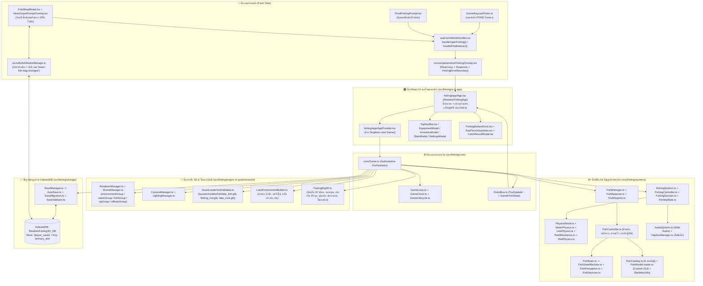

# 🌾 Beam Farm 3D — โครงสร้างโปรเจกต์ สถาปัตยกรรม การเชื่อมต่อโมดูล และ Dependencies

เอกสารนี้อธิบายโครงสร้างโค้ดทั้งหมดของเกม **Beam Farm 3D** แบบละเอียดชัดเจน ตั้งแต่ **NPM Dependencies**, **โครงสร้างโฟลเดอร์ทุกชั้น (Directory Tree)**, **ลำดับการเชื่อมต่อของข้อมูล (Data & Dependency Graph)**, **ไปป์ไลน์กล้องและการสัมผัสหน้าจอ 60 FPS แบบ Hay Day**, **กราฟฉาก 3D WebGL (Three.js)** ไปจนถึง **ระบบเซฟอัตโนมัติสองชั้น (`localStorage` + `IndexedDB`)**

---

## 1. 📦 รายละเอียด NPM Dependencies (`package.json`)

### 1.1 Runtime Dependencies (`dependencies`)
| แพ็กเกจ | เวอร์ชัน | หน้าที่และจุดที่เชื่อมต่อในโปรเจกต์ |
| :--- | :--- | :--- |
| **`react`** / **`react-dom`** | `^19.3.1` | แกนหลักจัดการ Component Tree, State Hooks (`useFarmEconomy`, `useFarmPlots`, `useFarmWorldHandlers`) และระบบ UI Modals/HUD ทั้งหมด (เริ่มต้นที่ `src/main.tsx` -> `src/App.tsx`) |
| **`three`** | `^0.186.1` | เอนจินกราฟิก 3D WebGL2 หลัก วาดภูมิประเทศ, หญ้า InstancedMesh, แปลงผัก, ต้นไม้, สัตว์, อาคาร `.glb`, ท้องฟ้ากลางคืน (ดวงจันทร์/ดาว), ตัวละครชาย-หญิง และระบบตกปลา 3D (`src/components/3d/*`, `src/fishing/*`) |
| **`lucide-react`** | `^0.546.0` | ชุดไอคอนเวกเตอร์คมชัดน้ำหนักเบา ใช้ใน HUD และหน้าต่างเมนูทั้งหมด (`src/components/ui/*`) |
| **`motion`** | `^12.43.0` | แอนิเมชันเสริมสำหรับ UI Transition บางส่วนโดยไม่กระทบ Render Loop ของ WebGL |
| **`@capacitor/core`** | `^8.6.0` | สะพานเชื่อม Web App เข้ากับ Android Native APK (`capacitor.config.ts`) รองรับการรันแบบเต็มจอบนมือถือ |
| **`express`** / **`dotenv`** | `^4.22.3` / `^17.4.2` | รองรับโครงสร้างเซิร์ฟเวอร์และการอ่านตัวแปรสภาพแวดล้อมตามมาตรฐานรันไทม์ |

### 1.2 Build & Development Dependencies (`devDependencies`)
| แพ็กเกจ | เวอร์ชัน | หน้าที่ในระบบ Build & Tooling |
| :--- | :--- | :--- |
| **`vite`** + **`@vitejs/plugin-react`** | `^8.3.5` / `^6.1.2` | Dev Server (Port `3000`) และตัวรวมไฟล์ Production Bundle ความเร็วสูง (`vite.config.ts`) |
| **`tailwindcss`** + **`@tailwindcss/vite`** | `^4.3.3` | ระบบจัดสไตล์ CSS แบบ Utility-First โหลดผ่าน `@import "tailwindcss";` ใน `src/index.css` |
| **`vite-plugin-pwa`** | `^2.0.0` | สร้าง Web App Manifest และ Service Worker (Workbox) แคชไฟล์โค้ด, รูปภาพ และโมเดล `.glb` ขนาดใหญ่เพื่อให้เล่นแบบ Offline และติดตั้งลงจอมือถือได้ |
| **`typescript`** | `^7.0.2` | ตรวจสอบชนิดข้อมูลแบบเข้มงวด (`npm run lint` -> `tsc --noEmit`) เชื่อมสัญญา Type กลางจาก `src/types/game.ts` |
| **`@types/three`**, **`@types/react`**, **`@types/react-dom`**, **`@types/node`** | ตรงตาม Runtime | Type Definitions สำหรับ Three.js, React 19 และ Node APIs |

---

## 2. 🗺️ แผนผังสถาปัตยกรรมการเชื่อมต่อทั้งระบบ (System Dependency Architecture)

แผนผังด้านล่างแสดงทิศทางการไหลของข้อมูล (ลูกศร `──►` คือ "เรียกใช้ / ส่ง Props หรืออ้างอิงไปยัง"):

```mermaid
graph TD
  subgraph Boot["1. Boot & Recovery Layer"]
    MAIN["src/main.tsx"] --> APP["src/App.tsx<br/>(AppErrorBoundary + LanguageProvider)"]
    APP --> AUTOSAVE["src/utils/farmAutoSave.ts<br/>(recoverFarmSaveFromIdbIfEmpty)"]
    APP --> SAVERESET["src/utils/saveReset.ts<br/>(wipeAllFarmSaveData / PRESERVED_PREF_KEYS)"]
    APP --> I18N["src/i18n/LanguageContext.tsx<br/>+ translations.ts (TH / EN)"]
  end

  subgraph Coordinator["2. Central Coordinator & Gameplay State Hooks"]
    APP --> FW["src/components/FarmWorld.tsx<br/>(ตัวกลางประสาน 3D Scene + Hooks + UI)"]
    FW --> H_NOTICE["useFloatingNotices.ts<br/>(ข้อความลอยแจ้งเตือน จำกัดไม่เกิน 5 ป้าย)"]
    FW --> H_ECON["useFarmEconomy.ts<br/>(เหรียญ, เพชร, XP, เลเวล, กระเป๋า, โรงกลั่น, เตาอบ, โรงอาหารสัตว์)"]
    FW --> H_PLOTS["useFarmPlots.ts<br/>(แปลงผัก, แปลงมีหลังคา 8 ช่อง, โซนที่ดิน 1-5, เติบโตตามเวลาจริง)"]
    FW --> H_TREES["useFarmTrees.ts<br/>(ต้นผลไม้ & ต้นไม้ซุง, รดน้ำ, เก็บผล, โค่นไม้)"]
    FW --> H_PLACE["useFarmPlacement.ts<br/>(วาง/ย้าย/หมุน อาคาร 0..30, สัตว์เลี้ยง, หิน, แต่งสี/PNG บ้าน)"]
    FW --> H_WORLD["useFarmWorldHandlers.ts<br/>(รวม Event Handlers, ซ่อนตัวละคร, โหมดนิ้ว Hay Day, ปุ่มย้อนกลับ)"]
    H_WORLD --> H_HARVEST["useHarvestMode.ts<br/>(เก็บเกี่ยวหมู่ / Batch Harvest)"]
    H_WORLD --> FISH_STORE["src/utils/fishMarketStorage.ts<br/>(กระเป๋าปลาเชื่อมโหมดตกปลากับร้านรับซื้อปลา)"]
  end

  subgraph WebGL3D["3. 3D WebGL Scene & 60 FPS Touch Pipeline"]
    FW --> SCENE["src/components/3d/FarmScene.tsx<br/>(WebGLRenderer + RequestAnimationFrame Loop)"]
    SCENE --> TOUCH_HOOK["src/hooks/useHayDayTouchCamera.ts<br/>(ดักนิ้ว/เมาส์บน DOM ตรง ไม่ให้ React รีเรนเดอร์)"]
    TOUCH_HOOK --> CAM_CTRL["src/engine/camera/HayDayCameraController.ts<br/>(ลาก 1:1 บนระนาบ y=0 + ความเฉื่อย Inertia + ซูม 2 นิ้ว)"]
    TOUCH_HOOK --> PICKER["src/components/3d/scene/SceneRaycastPicker.ts<br/>(Raycasting แตะแปลง/ต้นไม้/อาคาร/สัตว์/สระน้ำ/ปาดนิ้ว/กดค้าง)"]
    PICKER --> GHOST["src/components/3d/scene/SceneGhostPreview.ts<br/>(พรีวิวเงาวางสิ่งปลูกสร้างเขียว/แดง)"]

    SCENE --> LIGHTING["src/core/Lighting.ts + FarmNightSky.ts<br/>(แสงเช้า-กลางวัน-เย็น-ค่ำ + ดวงจันทร์ & ดวงดาว)"]
    SCENE --> TERRAIN["FarmTerrain.ts + FarmTerrainMap2.ts + FarmGrass.ts<br/>(พื้นเกาะหลัก, แม่น้ำ, สะพาน, บ่อน้ำ, โซนขยาย Map 2, หญ้าพลิ้ว)"]
    SCENE --> STRUCTURES["FarmHouses.ts -> structures/*<br/>(บ้านพัก, โรงกลั่น, เตาอบ, โรงอาหารสัตว์, ร้านปลา, แปลงมีหลังคา + PNG Shader)"]
    SCENE --> CROPS_TREES["FarmCrops.ts + FarmTrees.ts + FarmRocks.ts + FarmGridOverlay.ts"]
    SCENE --> ANIMALS3D["FarmAnimals.ts -> animals/*<br/>(ไก่, วัว, ม้า, เป็ด, แกะ, หมู, แพะ, สุนัข, แมว)"]
    SCENE --> PLAYER3D["FarmPlayer.ts + PlayerOutfitSystem.ts<br/>(ตัวละครชาย/หญิง, ชุดแฟชั่น PNG, ซ่อน/แสดงตัวละคร)"]
    FW --> DRONE["DroneAutoHarvest.tsx + HarvestSelection.tsx"]
  end

  subgraph UILayer["4. HUD & Modal Overlays (ทุกส่วนครอบด้วย data-ui)"]
    FW --> TOPHUD["TopHUD.tsx (เหรียญ, เพชร, เลเวล, พลังกาย, เวลา/ชมดาว)"]
    FW --> BUILDUI["BuildUI.tsx + BottomDock.tsx<br/>(ปุ่มสร้าง, อุปกรณ์, ซ่อนชาย-หญิง, โหมดปาดนิ้ว, แต่งบ้าน/เสื้อผ้า)"]
    BUILDUI --> DECOR_UI["HouseDecorMenuPanel.tsx + OutfitMenuPanel.tsx<br/>(อัปโหลดรูป .PNG / เปลี่ยนสีแยกชิ้นส่วน)"]
    FW --> NEAR_UI["NearHousePromptOverlay.tsx + CoveredPlotQuickBar.tsx + PondFishingPrompt.tsx"]
    FW --> MODALS["FarmModalsOverlay.tsx<br/>(รวมหน้าต่างครัว, โรงกลั่น, เตาอบ, โรงอาหารสัตว์, ร้านปลา, กระเป๋า, ตั้งค่า 4K/60fps)"]
    FW --> FISHING_APP["FishingOverlay.tsx -> src/fishing/*<br/>(เอนจินมินิเกมตกปลา 3D เต็มจอแยกอิสระ)"]
  end
```



---

## 3. 📂 โครงสร้างโฟลเดอร์และไฟล์ทั้งหมด (Directory Structure)

```text
/
├── index.html                      # HTML หลัก, Meta SEO/PWA, โหลดฟอนต์และสคริปต์เข้า src/main.tsx
├── metadata.json                   # ข้อมูลชื่อแอป คำอธิบาย และสิทธิ์ของ AI Studio Applet
├── package.json                    # รายการแพ็กเกจ NPM และคำสั่งสคริปต์ (dev, build, preview, lint)
├── vite.config.ts                  # ตั้งค่า Vite + Tailwind v4 + VitePWA (แคชโมเดล .glb เล่นออฟไลน์)
├── capacitor.config.ts             # ตั้งค่าแปลงเว็บเป็นแอปมือถือ Android APK
├── public/                         # ไฟล์โมเดล 3D (.glb) และไอคอน PWA ที่เสิร์ฟตรงผ่าน URL ราก "/"
│   ├── 2Vegetable _plot.glb        # โมเดลแปลงผักแบบมีหลังคา (ปลูกผักได้ 8 ช่องย่อยพร้อมกัน)
│   ├── Animal feed making machine.glb # เครื่องผลิตอาหารสัตว์
│   ├── Fish-buying shop.glb        # ร้านรับซื้อปลาสด
│   ├── PieOven.glb / bakery-interior.glb # เตาอบพาย & เตาอบขนมปัง/พิซซ่า
│   ├── man.glb / woman.glb         # โมเดลชาวไร่ชาย / ชาวไร่หญิง
│   ├── chicken.glb / cow.glb / horse.glb / duck_walk.glb # โมเดลสัตว์เลี้ยง 3D
│   ├── drone.glb / tractor.glb / windmill.glb / water-tower.glb ... # สิ่งปลูกสร้างและอุปกรณ์
│   ├── assets/models/              # โมเดล 3D เฉพาะของโหมดตกปลา (เสิร์ฟผ่าน /assets/models/*)
│   │   ├── fish/lake_fish.glb      # โมเดลปลาหลัก (และรองรับไฟล์เสริมรายสายพันธุ์ เช่น fish3.glb)
│   │   ├── equipment/fishing_rod.glb # โมเดลคันเบ็ดพื้นฐาน
│   │   └── environments/lake_rock.glb # โมเดลโขดหินริมทะเลสาบตกปลา
│   └── icons/ & pwa-*.png          # ไอคอนสำหรับติดตั้งแอป PWA บนมือถือ/แท็บเล็ต
│
└── src/
    ├── main.tsx                    # จุดเริ่มต้น React DOM Root เรียก <App />
    ├── App.tsx                     # ErrorBoundary + กู้คืนเซฟจาก IndexedDB ก่อนเรนเดอร์ + รีเซ็ตเซสชันเกม
    ├── index.css                   # นำเข้า Tailwind CSS (@import "tailwindcss";) และ Safe-Area มือถือ
    │
    ├── types/
    │   └── game.ts                 # ศูนย์รวม Type, Interface, ค่าคงที่ของพืช (CROP_DEFINITIONS), ต้นไม้ (TREE_DEFINITIONS),
    │                               # อาคาร 0..30 (HOUSE_DEFS), สัตว์ (ANIMAL_DEFS), หิน, สูตรอาหาร/เครื่องดื่ม/ขนมปัง/อาหารสัตว์
    │
    ├── data/
    │   └── terrainFeatures.ts      # พิกัดภูมิศาสตร์ของเกาะ (แม่น้ำ RIVER, สระตกปลา POND, ถนน, สะพาน) ใช้เช็กการชนและวางของ
    │
    ├── i18n/
    │   ├── LanguageContext.tsx     # React Context สลับภาษา ไทย (th) <-> อังกฤษ (en) แบบทันที
    │   └── translations.ts         # พจนานุกรมชื่อพืช สัตว์ อาคาร ข้อความแจ้งเตือน และฟังก์ชัน tr(th, en)
    │
    ├── utils/                      # โมดูลอรรถประโยชน์ระดับระบบ (ไม่มีการผูกติดกับ UI Component)
    │   ├── farmAutoSave.ts         # ระบบเซฟอัตโนมัติ 2 ชั้น (localStorage + IndexedDB Mirror) + คำนวณเวลาออฟไลน์
    │   ├── saveReset.ts            # ล้างข้อมูลเซฟทั้งหมดอย่างปลอดภัยโดยคงค่าตั้งค่าภาพ/ภาษา/ซ่อนตัวละครไว้
    │   ├── graphics4k.ts           # คำนวณ PixelRatio และเงาสำหรับโหมด Smooth 60 FPS / Standard HD / 4K Ultra HD
    │   ├── pngStructureSkin.ts     # ย่อและแปลงไฟล์รูป .PNG ของผู้เล่นเป็น DataURL Texture สำหรับทาบ้านและเสื้อผ้า
    │   ├── fishMarketStorage.ts    # ตัวกลางอ่าน-เขียนกระเป๋าปลาจาก IndexedDB ของโหมดตกปลามาสู่ร้านรับซื้อปลาในฟาร์ม
    │   ├── glbThumbnail.ts         # เรนเดอร์ภาพตัวอย่างไอคอน 3D อัตโนมัติจากไฟล์ .glb ลงแคชแสดงในเมนูสร้าง
    │   ├── glbValidator.ts         # ตรวจสอบ WebGL GPU มือถือ และการโหลดไฟล์ .glb อย่างปลอดภัย
    │   ├── offlineAssets.ts        # ดาวน์โหลดโมเดล .glb เก็บลง Cache Storage ล่วงหน้าเพื่อเล่นออฟไลน์ 100%
    │   ├── audio.ts                # สังเคราะห์เสียงดนตรีบรรยากาศและเอฟเฟกต์ (รดน้ำ, เก็บเกี่ยว, เหรียญ, สัตว์ร้อง) ด้วย Web Audio API
    │   ├── calculus.ts             # ฟังก์ชันคณิตศาสตร์ความเร็วสูง (clamp, exponentialDamp) สำหรับกล้อง 60 FPS
    │   └── textures.ts             # สร้าง Procedural Canvas Textures สำหรับพื้นดิน หญ้า น้ำ และลายไม้
    │
    ├── hooks/                      # สมองกลจัดการสถานะเกม (Gameplay & Input Hooks)
    │   ├── useFarmWorldHandlers.ts # ตัวประสาน Event ทั้งหมด: แตะแปลง/ต้นไม้/อาคาร/สระน้ำ, ซ่อนคน, ปาดนิ้ว, กล้อง, ปุ่ม Back
    │   ├── useFarmEconomy.ts       # ระบบเศรษฐกิจ: เหรียญ, เพชร, XP, เลเวลอัป, กระเป๋าเก็บของ, คิวโรงกลั่น/เตาอบ/อาหารสัตว์
    │   ├── useFarmPlots.ts         # ระบบแปลงผัก: สถานะ EMPTY->PLOWED->PLANTED->GROWING->READY, ซื้อเมล็ดอัตโนมัติ, แปลงมีหลังคา
    │   ├── useFarmTrees.ts         # ระบบต้นไม้ยืนต้น: ปลูกต้นกล้า, รดน้ำ, เก็บผลไม้, โค่นต้นไม้เอาซุง
    │   ├── useFarmPlacement.ts     # ระบบจัดผังฟาร์ม: ตรวจการชน, ซื้อ/วาง/ย้าย/หมุน/เก็บ อาคาร สัตว์ หิน และบันทึกสี/ลาย PNG บ้าน
    │   ├── useHayDayTouchCamera.ts # Hook ดักจับนิ้วสัมผัสบน DOM โดยตรง (Tap, Double-Tap, Long-Press 380ms, Drag, Pinch, Swipe)
    │   ├── useHarvestMode.ts       # โหมดเลือกเก็บเกี่ยวผลผลิตพร้อมกันหลายจุด (Batch Harvest)
    │   ├── useFloatingNotices.ts   # คิวข้อความลอยแจ้งเตือนบนหน้าจอ (จำกัดสูงสุด 5 ข้อความพร้อมกันเพื่อความลื่น)
    │   ├── useOnlineStatus.ts      # ตรวจจับสถานะ Online / Offline ของอุปกรณ์
    │   └── usePWAInstall.ts        # จัดการ Prompt ติดตั้งแอปลงหน้าจอโฮม (iOS / Android / Desktop)
    │
    ├── engine/ & core/ & game/     # ระบบแกนกลาง 3D, กล้อง, แสง และการบังคับตัวละคร
    │   ├── engine/camera/HayDayCameraController.ts # กล้อง 3D สไตล์ Hay Day ลากติดนิ้ว 1:1 บนระนาบ y=0 + ความเฉื่อย Inertia
    │   ├── core/Lighting.ts        # จัดแสงอาทิตย์ แสงท้องฟ้า หมอก และการไล่สี 4 ช่วงเวลา (เช้า, เที่ยง, พลบค่ำ, กลางคืน)
    │   └── game/player/
    │       ├── PlayerOutfitSystem.ts   # จัดการชุดเสื้อผ้า หมวก รองเท้า เครื่องประดับ และลายผ้า .PNG บนตัวละคร 3D
    │       ├── PlayerKeyboardWASD.ts   # ควบคุมการเดินด้วยปุ่ม W/A/S/D บนคีย์บอร์ด
    │       └── PlayerTouchSlideMove.ts # จอยสติ๊กจำลองสำหรับโหมดลากเดิน (ปิดอัตโนมัติเมื่อซ่อนตัวละครหรือเปิดโหมดลากจอ Hay Day)
    │
    ├── components/
    │   ├── FarmWorld.tsx           # คอมโพเนนต์หลักที่เชื่อม Hooks ทั้งหมดเข้ากับ <FarmScene /> และ UI Overlays
    │   ├── 3d/                     # โลก 3 มิติ (Three.js Objects)
    │   │   ├── FarmScene.tsx       # สร้าง WebGLRenderer, Scene, Render Loop 60fps และซิงก์ State จาก React สู่ Three.js
    │   │   ├── FarmNightSky.ts     # ท้องฟ้ายามค่ำ: ดวงจันทร์เรืองแสง (Moon Glow) และหมู่ดาวระยิบระยับ (Twinkling Stars)
    │   │   ├── FarmTerrain.ts      # แผ่นดินฟาร์มหลัก แม่น้ำ สระน้ำตกปลา สะพานไม้ และถนนดิน
    │   │   ├── FarmTerrainMap2.ts  # พื้นที่ขยายฝั่งตะวันตก (โซนที่ 5 ข้ามแม่น้ำ)
    │   │   ├── FarmGrass.ts        # ทุ่งหญ้า 3D แบบ InstancedMesh พลิ้วตามลม (เว้นระยะรอบบ้าน/แปลงผักอัตโนมัติ)
    │   │   ├── FarmHouses.ts       # ตัวจัดการสิ่งปลูกสร้างทั้งหมดในฉาก (Type 0..30) และเงาพรีวิวตอนวาง
    │   │   ├── structures/         # โมดูลย่อยสร้างโมเดลอาคารแต่ละชนิด + ระบบทาสี/แปะรูป PNG แยกชิ้นส่วน:
    │   │   │   ├── HousePaintShader.ts     # ระบบทาสีและ UV Mapping รูป .PNG แยกส่วน (หลังคา/ผนัง/รั้ว/พื้น/ปล่องไฟ)
    │   │   │   ├── ResidentialHouses.ts    # บ้านพักชาวไร่ & วิลล่า
    │   │   │   ├── CoveredVegetablePlot.ts # แปลงผักแบบมีหลังคา (2Vegetable _plot.glb)
    │   │   │   ├── BreweryFactory.ts       # โรงกลั่นเครื่องดื่มและถังหมัก
    │   │   │   ├── BakeryOven.ts           # เตาอบขนมปัง พิซซ่า และพาย พร้อมตะกร้าสายพาน
    │   │   │   ├── AnimalFeedMachine.ts    # เครื่องผลิตอาหารสัตว์พร้อมถุงอาหารลอยเก็บอัตโนมัติ
    │   │   │   ├── FishBuyingShop.ts       # ร้านรับซื้อปลาสดพร้อมเอฟเฟกต์ฉลองตอนขายปลา
    │   │   │   └── ChickenCoop.ts / DuckCoop.ts / AnimalEnclosures.ts / FarmInfrastructure.ts
    │   │   ├── FarmCrops.ts        # เรนเดอร์แปลงดิน ผักกำลังโต หยดน้ำ และป้ายพร้อมเก็บเกี่ยว
    │   │   ├── FarmTrees.ts        # เรนเดอร์ต้นกล้า ต้นไม้ใหญ่ และผลไม้สุกบนต้น
    │   │   ├── FarmAnimals.ts & animals/* # สัตว์เลี้ยงเดินสุ่มในรัศมีคอก แสดงหัวใจตอนลูบตัว
    │   │   ├── FarmPlayer.ts       # ตัวละครชาวไร่ชาย/หญิง แอนิเมชันเดิน ถือเครื่องมือ และฟังก์ชันซ่อนตัวละคร (setCharacterHidden)
    │   │   ├── DroneAutoHarvest.tsx # โดรนบินเก็บเกี่ยวและรดน้ำอัตโนมัติในรัศมีฟาร์ม
    │   │   └── scene/
    │   │       ├── SceneRaycastPicker.ts # ตัวแปลงพิกัดนิ้วแตะหน้าจอเป็นคำสั่งในโลก 3D (แปลงผัก, ต้นไม้, บ้าน, สัตว์, บ่อน้ำ)
    │   │       └── SceneGhostPreview.ts  # คำนวณกรอบวางสิ่งปลูกสร้างบนกริดและเช็กพื้นที่ว่างแบบเรียลไทม์
    │   │
    │   └── ui/                     # หน้าต่างเมนูและปุ่มควบคุมทั้งหมด (มีแอตทริบิวต์ data-ui เพื่อไม่ให้แย่งนิ้วลากกล้อง)
    │       ├── TopHUD.tsx          # แถบบน: เลเวล, XP, พลังกาย, เหรียญ, เพชร, ปุ่มเปลี่ยนเวลา & มุมกล้องชมพระจันทร์/ดาว
    │       ├── BuildUI.tsx         # ปุ่มซ้าย: เมนูสร้างบ้าน/สัตว์/หิน, ตกแต่งบ้าน, เสื้อผ้า, ปุ่มซ่อนชาย-หญิง, ปุ่มปาดนิ้ว Hay Day
    │       ├── BottomDock.tsx      # เมนูอุปกรณ์ทำฟาร์ม เมล็ดพันธุ์ ต้นกล้า ตารางกริด และโหมดเก็บเกี่ยวหมู่
    │       ├── HouseDecorMenuPanel.tsx # หน้าต่างเลือกสีและอัปโหลดไฟล์ .PNG แต่งบ้านแยก 5 ส่วน (หลังคา ผนัง รั้ว พื้น ปล่องไฟ)
    │       ├── OutfitMenuPanel.tsx # หน้าต่างแต่งตัวละครชาย/หญิง เปลี่ยนทรงหมวก เครื่องประดับ สีชุด และอัปโหลดลายผ้า .PNG
    │       ├── NearHousePromptOverlay.tsx # ปุ่มโต้ตอบด่วนเมื่ออยู่ใกล้อาคารหรือแตะแปลงมีหลังคา
    │       ├── CoveredPlotQuickBar.tsx    # แถบปลูกผัก/รดน้ำ/เก็บเกี่ยวด่วนสำหรับแปลงผักมีหลังคา
    │       ├── FarmModalsOverlay.tsx      # ตัวรวมหน้าต่าง Modal ทั้งหมด:
    │       │   ├── HouseInteriorModal.tsx # ในบ้านพัก: ทำอาหารเพิ่มพลังกาย & นอนหลับข้ามวัน
    │       │   ├── BreweryModal.tsx       # โรงกลั่นน้ำผลไม้ ไวน์ และเครื่องดื่มพรีเมียม
    │       │   ├── BakeryModal.tsx        # เตาอบขนมปัง พิซซ่า และพาย
    │       │   ├── AnimalFeedModal.tsx    # เครื่องโม่ผลิตอาหารไก่ อาหารวัว อาหารม้า อาหารเป็ด
    │       │   ├── FishShopModal.tsx      # ร้านรับซื้อปลาสดตามน้ำหนักและสายพันธุ์
    │       │   ├── InventoryModal.tsx     # คลังเก็บผลผลิต & ร้านค้าซื้อเมล็ดพันธุ์/ต้นกล้า
    │       │   ├── LandExpansionModal.tsx # ปลดล็อกขยายพื้นที่ฟาร์มโซน 2–5
    │       │   └── SettingsModal.tsx      # ตั้งค่าภาพ 4K / Smooth 60 FPS, ซ่อนตัวละคร, โหมดนิ้ว Hay Day, เซฟเกม, รีเซ็ตเกม
    │       └── FishingOverlay.tsx         # สะพานเชื่อม Lazy-Load + ErrorBoundary เปิดโหมดตกปลาเต็มจอ และส่งเหรียญ/XP เข้าฟาร์ม
    │
    └── fishing/                       # 🎣 ซับเอนจินเกมตกปลา 3D แยกส่วนอิสระ (Clean Modular Architecture)
        ├── app/                       # ชั้น React Entry & Context ของโหมดตกปลา
        │   ├── App.tsx                # RealisticFishingApp + GameViewportShell (ผูก WebGL Canvas, Keyboard, Pointer, Bridge เหรียญ/XP)
        │   └── AppProvider.tsx        # สร้างและถือครอง Singleton อินสแตนซ์ของคลาส Game ตลอดอายุการเปิดหน้าตกปลา
        │
        ├── core/                      # ชั้นแกนกลางควบคุมวงจรชีวิตและลูปเกม (Engine Kernel)
        │   ├── Game.ts                # ตัวประสานสูงสุด (Orchestrator): เชื่อม Renderer, Scene, Camera, Lighting, Lake, Rig3D, FishManager, FishingSystem, Audio, Save
        │   ├── GameLoop.ts            # ลูปเดียวทั้งระบบ: Fixed-Timestep Physics (60Hz) + Render Frame + ตัวหน่วงปลอดภัยบน Software WebGL
        │   ├── GameClock.ts           # คำนวณ Delta Time พร้อมเพดานกันเฟรมกระโดด (maxDeltaSeconds) และสถานะ Pause
        │   ├── GameConfig.ts          # ค่าคงที่หลัก (dockTipPosition, maxFishCount=14, fixedTimeStep=1/60, CameraPreset, WeatherType)
        │   ├── GameState.ts           # โครงสร้างข้อมูล GameHUDState Snapshot ที่ส่งจาก Game -> React UI ผ่าน EventBus
        │   ├── GameLifecycle.ts       # ดัก visibilitychange (พักเกมอัตโนมัติเมื่อสลับแอป) และ ResizeObserver ปรับขนาดจอ
        │   ├── EventBus.ts            # ระบบ Pub/Sub ความเร็วสูงส่งอีเวนต์ hudUpdate (~15 ครั้ง/วินาที) โดยไม่สร้างภาระให้ GC
        │   └── GameError.ts           # คลาสจัดการข้อผิดพลาดภายในซับเอนจินตกปลา
        │
        ├── engine/                    # ชั้นเรนเดอร์กราฟิก 3D, กล้อง, แสง และการตรวจสอบไฟล์ .glb
        │   ├── renderer/
        │   │   └── RendererManager.ts # สร้าง THREE.WebGLRenderer (ACESFilmicToneMapping, SRGBColorSpace, ตรวจจับ Software WebGL)
        │   ├── scene/
        │   │   └── SceneManager.ts    # สร้าง THREE.Scene + RoomEnvironment PMREM + แยก 5 Group (environment, water, fish, rig, effects) + คืนแรม GPU
        │   ├── camera/
        │   │   └── CameraManager.ts   # กล้องอัจฉริยะปรับมุมตามสถานะ (เล็งเหวี่ยง, ตามทุ่นลอย, สู้เบ็ดสั่นตามแรงดึง, ลากนิ้วหันมุมมอง)
        │   ├── lighting/
        │   │   └── LightingManager.ts # ระบบแสงและสภาพอากาศ 4 แบบ (Clear, Overcast, Rain, Sunset) + ฟ้าแลบ + หมอกใต้น้ำ
        │   └── animation/
        │       └── AssetLoaderAndValidator.ts # โหลดและตรวจความถูกต้องของโมเดลหลัก .glb (lake_fish.glb, fishing_rod.glb, lake_rock.glb)
        │
        ├── systems/                   # ชั้นระบบจำลองเกมเพลย์ ฟิสิกส์ ปัญญาประดิษฐ์ปลา เสียง และฉาก 3D
        │   ├── fishing/               # ระบบสถานะการตกปลาและการรับคำสั่งผู้เล่น
        │   │   ├── FishingState.ts    # ตาราง State Machine 12 สถานะของการตกปลา (IDLE -> CASTING -> WAITING -> BITE -> HOOKED -> FIGHTING/REELING -> LANDED -> RESULT ...)
        │   │   ├── FishingSession.ts  # เก็บค่าสดของรอบการตกปัจจุบัน (แรงเหวี่ยง, มุมเล็ง, ตำแหน่งทุ่น, แรงตึงสาย N, ความยาวสาย, ปลาที่ติดเบ็ด)
        │   │   ├── FishingController.ts # แปลอินพุตผู้เล่น (ปุ่มชาร์จเหวี่ยง, ตวัดเบ็ด, กรอสาย, จอยสติ๊กคู่ซ้าย-ขวา) เข้าสู่ FishingSession
        │   │   └── FishingSystem.ts   # สมองกลางคำนวณเกมเพลย์ทุก Fixed Tick: ลูกดอกทุ่นลอย, ปลาตอด/ฮุบเหยื่อ, สู้ปลา, สายขาด/หลุด, เอาปลาขึ้นฝั่ง
        │   │
        │   ├── fish/                  # ระบบฝูงปลา ข้อมูลสายพันธุ์ ตัวโหลดโมเดล GLB และ AI ปลาใต้น้ำ
        │   │   ├── FishManager.ts     # บริหารฝูงปลาทั้งหมดในบ่อ (สร้างเริ่มต้น 14 ตัว, ผูกเข้า fishGroup, ลบและเกิดใหม่เมื่อจับได้, ปล่อยปลาคืนบ่อ)
        │   │   ├── FishSpawner.ts     # สุ่มจุดเกิดใต้น้ำตามความลึกจริงของบ่อ (WaterPhysics.waterDepthAt) และความลึกที่ปลาแต่ละชนิดชอบ
        │   │   ├── FishRegistry.ts    # ค้นหาข้อมูลสายพันธุ์และสุ่มปลาแบบถ่วงน้ำหนัก (เพิ่มโอกาส 1.85x หากตรงกับเหยื่อที่เลือก)
        │   │   ├── FishController.ts  # ตัวตนปลาแต่ละตัว: สุ่มน้ำหนัก/ความยาว, พลังกาย Stamina, ความเร็ว 3 มิติ, แรงดึงสู้เบ็ด และซิงก์โมเดล GLB/AnimationMixer
        │   │   ├── data/
        │   │   │   ├── FishCatalog.ts     # ตารางสเปกปลาทั้ง 6 สายพันธุ์ (Rainbow Trout, Largemouth Bass, Giant Snakehead, Siamese Carp, Golden Mahseer, Arapaima) + ตั้งค่า GLB รายตัว
        │   │   │   └── FishModelLoader.ts # โหลดโมเดลปลา .glb แบบปลอดภัย (เช็ก Magic Header ป้องกันไฟล์ว่าง/404, โคลนกระดูกด้วย SkeletonUtils.clone แยก AnimationMixer รายตัว)
        │   │   └── ai/
        │   │       ├── FishStateMachine.ts # ตาราง AI State Machine 8 สถานะของปลา (PATROL, APPROACH_BAIT, NIBBLE, STRIKE_BITE, FLEE, FIGHT, TIRED, LANDED)
        │   │       ├── FishPerception.ts   # คำนวณการรับรู้เหยื่อใต้น้ำ (ระยะห่าง, กลิ่นดึงดูดเหยื่อ, ความพรางตัวของสายเอ็น, ความลึก -> desireScore)
        │   │       ├── FishDecision.ts     # ตัดสินใจว่าจะว่ายเข้าหาเหยื่อ ตอดหลอก (Nibble) หรือฮุบเต็มแรง (Strike Bite)
        │   │       └── FishBrain.ts        # คำนวณจุดหมายการว่ายแต่ละวินาที (ว่ายลาดตระเวน, วนตอดเข้า-ถอยออกรอบทุ่น, กระชากหนีสลับพักเหนื่อยตอนติดเบ็ด)
        │   │
        │   ├── physics/               # ระบบฟิสิกส์จำลองเชิงกลศาสตร์จริง
        │   │   ├── PhysicsConfig.ts   # ค่าคงที่แรงโน้มถ่วง แรงต้านอากาศ/น้ำ ขีดจำกัดสายขาดสะสม และเวลาสายหย่อนจนปลาหลุด
        │   │   ├── PhysicsWorld.ts    # จำลองวิถีโค้งโปรเจกไทล์ตอนเหวี่ยงทุ่นลอยในอากาศ + แรงลอยตัวทุ่นกระเพื่อมตามคลื่นและลม
        │   │   ├── water/WaterPhysics.ts      # สมการความลึกพื้นบ่อน้ำ (terrainHeightAt / waterDepthAt) และความสูงคลื่นผิวน้ำ
        │   │   ├── rod/RodPhysics.ts          # คำนวณการโค้งงอพาราโบลา 10 ปล้องของคันเบ็ดตามค่า Flexibility และแรงดึงสายจริง
        │   │   ├── reel/ReelMechanics.ts      # คำนวณอัตราทดการเก็บสายรอก แรงเบรกรอก (Drag Ratio) และการหมุนแกนสปูลเมื่อสายถูกปลากระชากออก
        │   │   └── fishing-line/LinePhysics.ts # สมการสปริง-แดมเปอร์ (Hooke's Law: Stiffness K + Damping C) คำนวณแรงตึงสาย (N), เบรกรอกสลิป, สายหย่อน และสายขาด
        │   │
        │   ├── equipment/             # ระบบอุปกรณ์ตกปลาและคลังอัปเกรด
        │   │   ├── EquipmentCatalog.ts # สเปกอุปกรณ์ 4 หมวด: คันเบ็ด (3 รุ่น), รอก (3 รุ่น), สายเอ็น (3 รุ่น), เหยื่อปลอม/เหยื่อสด (4 ชนิด)
        │   │   └── EquipmentManager.ts # รวมอุปกรณ์ที่สวมใส่อยู่เป็น ActiveEquipmentLoadout ส่งให้ระบบฟิสิกส์และกราฟิก
        │   │
        │   ├── world/                 # ระบบสร้างฉากทะเลสาบ 3D และชุดคันเบ็ด/ปลา 3D
        │   │   ├── LakeEnvironmentBuilder.ts # สร้างพื้นก้นบ่อ ผิวน้ำสะท้อนแสง ท่าเทียบเรือไม้ โขดหิน ต้นไม้ริมบ่อ วงคลื่นน้ำกระจาย และเม็ดฝน
        │   │   └── FishingRig3D.ts    # สร้างและอัปเดตคันเบ็ด 10 ปล้อง + รอกหมุนได้ + สายเอ็นโค้ง Catenary 24 จุด + ทุ่นลอย + ฟองอากาศใต้น้ำ + เรนเดอร์ปลาทั้งแบบ Custom GLB และ Articulated 3D Rig
        │   │
        │   └── audio/
        │       └── AudioSystem.ts     # สังเคราะห์เสียงตกปลาแบบ Procedural ด้วย Web Audio API (เสียงเหวี่ยงคัน, น้ำกระจาย, ปลาตอด, สัญญาณฮุบ, เสียงคลิกรอก/เบรกสลิป, สายขาด, ฝนและฟ้าร้อง)
        │
        ├── storage/                   # ชั้นฐานข้อมูลถาวรของโหมดตกปลา (IndexedDB)
        │   ├── SaveVersion.ts         # ชื่อฐานข้อมูล 'RealisticFishing3D_DB', Store 'player_saves', Slot 'primary_slot', Version 2
        │   ├── SaveSchema.ts          # โครงสร้างข้อมูลเซฟ (เลเวล/XP/เหรียญนักตกปลา, อุปกรณ์ที่ซื้อ/สวมใส่, กระชังปลา inventory, สถิติ, ตั้งค่า)
        │   ├── IndexedDBStorage.ts    # ตัวเชื่อมต่อ IndexedDB พร้อม Memory Fallback อัตโนมัติหากเบราว์เซอร์จำกัดสิทธิ์
        │   ├── SaveMigration.ts       # อัปเกรดโครงสร้างเซฟรุ่นเก่าให้เข้ากับ Schema ปัจจุบันโดยข้อมูลไม่หาย
        │   ├── SaveValidator.ts       # ตรวจสอบความถูกต้องของชนิดข้อมูลเซฟทุกฟิลด์ก่อนนำเข้าเกม
        │   ├── AutoSave.ts            # ระบบหน่วงเวลาเขียนเซฟอัตโนมัติ (Debounce) และสั่งบันทึกทันที (flush) ตอนพักเกม/เก็บปลา
        │   ├── BackupManager.ts       # ส่งออกข้อมูลเซฟนักตกปลาเป็นไฟล์ .json สำรองลงเครื่อง
        │   └── SaveManager.ts         # API หลักสำหรับ load / update / saveNow / flushPending / reset
        │
        ├── localization/              # ระบบแปลภาษาภายในโหมดตกปลา (5 ภาษา: TH, EN, JA, KO, ZH — ซิงก์ TH/EN กับฟาร์มอัตโนมัติ)
        │   ├── LanguageTypes.ts / LanguageStorage.ts / LanguageManager.ts / i18n.ts
        │   └── locales/               # th.json, en.json, ja.json, ko.json, zh.json
        │
        ├── platform/                  # ระบบเชื่อมต่อฮาร์ดแวร์มือถือและปุ่มย้อนกลับ
        │   ├── HapticsManager.ts      # สั่นมอเตอร์มือถือตามจังหวะปลาตอด/วัดเบ็ด/สายตึงใกล้ขาด พร้อมคำนวณค่าสั่นสะเทือนบน HUD
        │   ├── PlatformManager.ts     # ดักปุ่ม Back ของ Android / Browser (ปิด Modal -> พักเกม -> ออกจากบ่อกลับฟาร์มตามลำดับ)
        │   └── usePWAInstall.ts       # รองรับสถานะติดตั้ง PWA
        │
        └── ui/                        # หน้าจอ HUD, จอยสติ๊กคู่ และหน้าต่างเมนูในโหมดตกปลา
            ├── hud/TopNavBar.tsx               # แถบบน: ปุ่มกลับฟาร์ม, เหรียญ/เลเวลนักตกปลา, ปุ่มเปิดคลังอุปกรณ์/กระชังปลา/สถิติ/ตั้งค่า, ปุ่มพักเกม
            ├── fishing/FishingBottomDock.tsx   # แผงควบคุมล่างพับเก็บได้: มาตรวัดแรงตึงสาย (Tension Bar + โซนปลอดภัย), ปุ่มชาร์จเหวี่ยง/วัดเบ็ด/กรอสาย, ปรับเบรกรอก Drag +/-, มุมกล้อง
            ├── fishing/DualTouchJoysticks.tsx  # จอยสติ๊กคู่บนจอมือถือ: ซ้ายโยกคันเบ็ดงัดสู้ทิศทางปลาว่าย / ขวาหมุนควงแขนรอกตามความเร็วนิ้วจริง
            ├── dialogs/CatchResultModal.tsx    # หน้าต่างโชว์ปลาที่ตกได้ (น้ำหนัก, ความยาว, ความหายาก, สถิติใหม่) เลือก "เก็บใส่กระชัง" หรือ "ปล่อยคืนบ่อรับโบนัส XP"
            ├── equipment/EquipmentModal.tsx    # ร้านค้าซื้อและสลับสวมใส่ คันเบ็ด / รอก / สายเอ็น / เหยื่อ
            ├── inventory/InventoryModal.tsx    # กระชังปลา: ดูรายการปลาที่จับได้ ขายทีละตัวหรือขายทั้งหมดทันที
            ├── menus/StatsModal.tsx            # สมุดสถิตินักตกปลา (จำนวนเหวี่ยง, จับสำเร็จ, น้ำหนักสูงสุด, ปลาหลุด, สายขาด)
            ├── settings/SettingsModal.tsx & LanguageSelector.tsx # ปรับสภาพอากาศสด, เสียง, เปิด-ปิดจอยสติ๊กคู่, ระบบสั่น Haptics, สำรอง/รีเซ็ตเซฟตกปลา
            └── components/PWAInstallControl.tsx # แถบแจ้งเตือนสถานะออฟไลน์
```

---

## 4. 🔗 รายละเอียดการทำงานร่วมกันของแต่ละระบบสำคัญในฟาร์ม (Core Farm Workflows)

### 4.1 ระบบใช้นิ้วทำทุกอย่างแทน & ซ่อนตัวละครชาย-หญิง (Hay Day Finger & Hidden Avatar Flow)
1. **การดักนิ้วระดับ 60 FPS (`useHayDayTouchCamera.ts`)**:
   - ผูก Event Listener (`pointerdown`, `pointermove`, `pointerup`, `wheel`) เข้ากับ `<div data-farm-canvas>` โดยตรง **ไม่ผ่าน `useState` ของ React** ทำให้ลากกล้องได้ 60 FPS นิ่งสนิทโดยที่ React ไม่ต้อง Re-render แม้แต่ครั้งเดียว
   - ทุกปุ่มบนหน้าจอ UI จะอยู่ใน `<div data-ui>` เสมอ หาก `e.target.closest('[data-ui]')` เป็นจริง Hook จะปล่อยผ่านให้กดปุ่ม UI ได้ทันทีโดยไม่ลากจอ
2. **การแยกแยะท่าทางนิ้ว (Gesture Resolution)**:
   - **ลาก 1 นิ้วปกติ**: ส่งพิกัดเข้า `HayDayCameraController.dragMove()` คำนวณจุดตัดบนระนาบพื้นดิน `y = 0` ทำให้ผืนหญ้าเกาะติดปลายนิ้วแบบ 1:1 พร้อมแรงเฉื่อย (Inertia) ตอนปล่อยนิ้ว
   - **เปิดโหมดปาดนิ้ว (`fingerSwipeEnabled = true`)**: ลาก 1 นิ้วจะเรียก `SceneRaycastPicker.handleSwipePick()` ยิง Raycast ต่อเนื่องผ่านแปลงผักและต้นผลไม้เพื่อเก็บเกี่ยว/รดน้ำ/ปลูกในปาดเดียว (ส่วนตัวกล้องสลับไปใช้ 2 นิ้วเลื่อน/ซูมอัตโนมัติ)
   - **แตะสั้น 1 ครั้ง (`onPick`)**: ส่งต่อไปยัง `SceneRaycastPicker.handlePick()`:
     - แตะ **สระน้ำ (`POND`)** -> เรียก `handlePondInteract()` เปิดโหมดตกปลาทันที
     - แตะ **แปลงผัก (`FarmCrops3D`)** -> เรียก `handlePlotClick()` -> `interactPlot()` ซึ่งตรวจสอบสถานะแปลงอัตโนมัติ (`EMPTY` พรวนดิน -> `PLOWED` หว่านเมล็ดและซื้อเมล็ดให้อัตโนมัติถ้าของหมด -> `PLANTED/GROWING` รดน้ำ -> `READY` เก็บเกี่ยว)
     - แตะ **ต้นไม้ (`FarmTrees3D`)** -> เก็บผลไม้สุก หรือรดน้ำต้นอ่อน หรือแตะซ้ำ 2 ครั้งเพื่อตัดไม้ซุง
     - แตะ **อาคาร/คอกสัตว์ (`FarmHouses3D`)** -> เรียก `handleHouseInteract(houseId)` เปิดหน้าต่างโรงผลิต/ครัว/ร้านปลา หรือเก็บผลผลิตคอกสัตว์ได้ทันทีโดยไม่ต้องเดินตัวละครไปใกล้
     - แตะ **สัตว์เลี้ยง (`FarmAnimals3D`)** -> เรียก `handleAnimalPetFromScene()` ลูบตัวสัตว์รับ XP/ขนเป็ดทันที
   - **กดค้าง ~0.38 วินาที (`onLongPress`) หรือแตะ 2 ครั้งติดกัน (`onDoublePick`)**: เลือกสิ่งปลูกสร้าง หิน หรือสัตว์เลี้ยงเพื่อเปิดแถบ **ย้าย / หมุน 90° / ตกแต่ง PNG / เก็บเข้าคลัง**
3. **การซ่อนตัวละครชาย-หญิง (`isPlayerHidden`)**:
   - เมื่อกดปุ่มซ่อนตัวละครใน `BuildUI`, `OutfitMenuPanel` หรือ `SettingsModal` -> `useFarmWorldHandlers.handleTogglePlayerHidden()` จะบันทึกค่าลง `localStorage` และ `WorldSessionSaveState`
   - ส่ง Prop `isPlayerHidden` เข้า `FarmScene.tsx` -> เรียก `FarmPlayer3D.setCharacterHidden(true)` ซ่อน Group โมเดลและเงาพื้น หยุดคำนวณแอนิเมชันโครงกระดูก ปิด WASD/Touch-Slide และไม่ให้การแตะพื้นสั่งตัวละครเดิน

---

### 4.2 ระบบตกแต่งบ้าน & เสื้อผ้าด้วยสีและไฟล์รูป `.PNG` (Custom Color & PNG Skinning Pipeline)
1. ผู้เล่นเลือกสีหรืออัปโหลดไฟล์ `.png` ใน `HouseDecorMenuPanel.tsx` (แยก 5 ส่วน: หลังคา `roof`, ผนัง `wall`, รั้ว `fence`, พื้น `floor`, ปล่องไฟ `chimney`) หรือใน `OutfitMenuPanel.tsx` (หมวก, เสื้อ, กางเกง/เอี๊ยม, รองเท้า, เครื่องประดับ)
2. `src/utils/pngStructureSkin.ts` ย่อขนาดรูปภาพให้เหมาะกับหน่วยความจำการ์ดจอ (VRAM) แล้วแปลงเป็น `DataURL`
3. ข้อมูลสไตล์ถูกบันทึกแยกชิ้นใน:
   - บ้าน: `PlacedHouse.partStyles` ผ่าน `useFarmPlacement.ts` -> ส่งเข้า `FarmHouses.ts` -> `structures/HousePaintShader.ts` สร้าง `THREE.Texture` ตั้งค่า `RepeatWrapping` + `SRGBColorSpace` ทาลงเฉพาะ Mesh ชิ้นส่วนที่ตรงเงื่อนไขชื่อวัสดุ/รูปทรง
   - เสื้อผ้า: `PlayerOutfitConfig` ผ่าน `PlayerOutfitSystem.ts` (เก็บถาวรใน IndexedDB + localStorage) -> ส่งเข้า `FarmPlayer.ts` อัปเดตวัสดุบนโมเดลชาวไร่ชาย/หญิงทันทีแบบเรียลไทม์

---

### 4.3 ระบบปรับกราฟิก Smooth 60 FPS / Standard HD / 4K Ultra HD (`graphics4k.ts`)
- ควบคุมจาก `SettingsModal.tsx` -> `useFarmWorldHandlers.handleSetGraphicsQualityMode()` -> `FarmScene.tsx` เรียก `applySceneUltra4kQuality()`:
  - **`smooth` (Smooth 60 FPS สำหรับมือถือ)**: จำกัด Pixel Ratio ไม่เกิน `1.0–1.25`, ปิดเงาหนัก/ลดความหนาแน่นใบหญ้า `FarmGrass3D` เพื่อให้มือถือรุ่นกลางวิ่งลื่น 60 FPS
  - **`standard` (Standard HD)**: สมดุลความคมชัดและเงามาตรฐาน
  - **`ultra4k` (4K Ultra HD)**: คำนวณ Supersampling `setPixelRatio` ให้ความละเอียด Framebuffer พุ่งขึ้นระดับ `3840×2160` (ภายในขีดจำกัด `MAX_RENDERBUFFER_SIZE` ของ GPU เครื่องนั้นๆ เพื่อป้องกันจอดำ) พร้อมเพิ่ม Shadow Map สูงสุด `4096×4096` และ Anisotropic Filtering สูงสุด
- เมื่อเปิดโหมดตกปลา (`FishingOverlay` เต็มจอ) `FarmScene` จะได้รับ `renderPaused={true}` เพื่อหยุด Loop วาดฟาร์มและลดขนาด Framebuffer ชั่วคราวเป็น `1×1` คืน VRAM ให้ฉากน้ำ 3D เต็มที่ แล้วกู้คืนความละเอียดเดิมทันทีเมื่อออกจากบ่อตกปลา

---

### 4.4 ระบบเซฟอัตโนมัติสองชั้น และการป้องกันข้อมูลหาย (`farmAutoSave.ts` & `saveReset.ts`)
1. **การเขียนเซฟอัตโนมัติ (Dual-Layer Auto-Save)**:
   - ทุกครั้งที่เหรียญ แปลงผัก ต้นไม้ สิ่งปลูกสร้าง สัตว์เลี้ยง หรือตำแหน่งผู้เล่นเปลี่ยน Hook แต่ละตัวจะเรียก `createAutoSaveChannel(...).schedule()` (Debounce สั้น `250ms` พร้อมเพดาน `maxWaitMs`)
   - บันทึกลง **`localStorage`** ทันที และสำรองข้อมูลชุดเดียวกันลงฐานข้อมูล **`IndexedDB` (`beam_farm_autosave_db_v1`)** เบื้องหลัง พร้อมดักเหตุการณ์ `visibilitychange`, `pagehide`, `beforeunload` เพื่อ `flushAllPendingFarmSaves()` ก่อนปิดแอปหรือสลับหน้าจอมือถือ
2. **การกู้คืนเซฟตอนเปิดเกม (`App.tsx`)**:
   - ก่อนสร้าง `<FarmWorld />` ระบบจะรัน `recoverFarmSaveFromIdbIfEmpty()` หากเบราว์เซอร์เผลอล้าง `localStorage` ระบบจะดึงข้อมูลล่าสุดจาก `IndexedDB` กลับมาเติมให้อัตโนมัติก่อนโหลดสถานะเกม
3. **การรีเซ็ตเกมแบบสมบูรณ์ (`wipeAllFarmSaveData` ใน `saveReset.ts`)**:
   - ระงับช่องทาง Auto-Save ชั่วคราว (`_saveSuppressed = true`) -> ลบคีย์เซฟทั้งหมดใน `FARM_SAVE_KEYS` และล้างตารางใน `IndexedDB` (รวมถึงกระเป๋าปลา `clearFishingSaveData()`) โดยเก็บเฉพาะคีย์การตั้งค่าใน `PRESERVED_PREF_KEYS` (เช่น ภาษา, โหมดภาพ 4K/60FPS, การซ่อนตัวละคร, โหมดปาดนิ้ว) -> รีเมานต์ `FarmWorld` ด้วย `gameSessionKey + 1` เพื่อเริ่มฟาร์มวันที่ 1 ใหม่อย่างสะอาด 100%

---

## 5. 🎣 โครงสร้างและสถาปัตยกรรมระบบตกปลา 3D แบบเจาะลึก (`src/fishing/*` Full Dependency & Data Flow)

ระบบตกปลาถูกออกแบบเป็น **Standalone 3D Sub-Engine** ที่แยกออกจากฉากฟาร์มหลักอย่างเด็ดขาด (โหลดแบบ **Code-Splitting `React.lazy`** เมื่อผู้เล่นกดเข้าตกปลาเท่านั้น) แต่เชื่อมต่อกระเป๋าเงิน, XP, ภาษา และคลังปลาสดเข้ากับฟาร์มแบบไร้รอยต่อ

### 5.1 แผนผังการเชื่อมต่อโมดูลภายใน `src/fishing/*` และสะพานเชื่อมฟาร์ม (Fishing Dependency Graph)



---

### 5.2 ช่องทางเชื่อมต่อระหว่าง "ฟาร์มหลัก" กับ "โหมดตกปลา" (4 จุดเชื่อมต่อหลัก)

| ลำดับ | จุดเชื่อมต่อ | ไฟล์ต้นทาง ──► ไฟล์ปลายทาง | รายละเอียดการทำงานร่วมกัน |
| :---: | :--- | :--- | :--- |
| **1** | **การเข้าสู่โหมดตกปลา (3 ช่องทาง)** | 1) `SceneRaycastPicker.ts` (`isRayHittingPond`)<br/>2) `PondFishingPrompt.tsx`<br/>3) `FishShopModal.tsx` ──► `useFarmWorldHandlers.handleOpenFishing()` | 1) บันทึกเซฟฟาร์มที่ค้างอยู่ทั้งหมดทันที (`flushAllPendingFarmSaves()`)<br/>2) ปิดเพลงพื้นหลังฟาร์มชั่วคราว และส่ง `renderPaused={true}` ให้ `FarmScene.tsx` พักการวาดฉากฟาร์มเพื่อคืน VRAM<br/>3) เรนเดอร์ `<FishingOverlay />` โหลดโค้ดตกปลาแบบ Lazy Chunk พร้อม `FishingErrorBoundary` ป้องกันหน้าขาว |
| **2** | **การซิงก์เหรียญและ XP เข้าฟาร์มสดๆ** | `fishing/core/Game.ts` (`hudUpdate`) ──► `fishing/app/App.tsx` ──► `FishingOverlay.tsx` ──► `useFarmEconomy` (`earnCoins`, `addXP`) | - เมื่อผู้เล่นกดขายปลาในหน้าตกปลา `App.tsx` จะคำนวณส่วนต่างเหรียญที่ **เพิ่มขึ้นจริง** (`diff > 0` เพื่อไม่ให้ตอนซื้อเบ็ด/เหยื่อไปหักเงินฟาร์มซ้ำ) แล้วเรียก `onCoinsEarned(diff)` เติมเหรียญเข้ากระเป๋าฟาร์มทันที<br/>- เมื่อดึงปลาขึ้นฝั่งสำเร็จ (`outcome === 'landed'`) จะส่ง `xpEarned` เข้าเลเวลฟาร์มผ่าน `onXpEarned` ครั้งเดียวต่อปลา 1 ตัว |
| **3** | **กระชังปลาร่วมกับร้านรับซื้อปลาในฟาร์ม** | `Game.keepCaughtFish()` ──► `IndexedDB ('RealisticFishing3D_DB')` ◄── `src/utils/fishMarketStorage.ts` ──► `FishShopModal.tsx` | - เมื่อกด **"เก็บปลา"** ในโหมดตกปลา ข้อมูลปลา (`speciesId`, `weightKg`, `lengthCm`, `rarity`, `valueCoins`) จะถูกบันทึกลง `save.inventory` ใน IndexedDB พร้อมยิง CustomEvent ชื่อ `'beam-fish-bag-changed'`<br/>- ฝั่งฟาร์ม (`useFarmWorldHandlers.ts`) ดักฟังอีเวนต์นี้และโหลดรายการปลามาแสดงที่อาคาร **ร้านรับซื้อปลาสด (`Fish-buying shop.glb`, Type 29)**<br/>- ถ้านำปลามาขายที่ร้านในฟาร์ม จะได้ **โบนัสราคาสด +15% (`FISH_SHOP_BONUS_RATE = 1.15`)** + XP ฟาร์ม + เอฟเฟกต์ฉลองหน้าร้าน 3D (`fishSaleTrigger`) พร้อมซิงก์เหรียญกลับเข้าเซฟโหมดตกปลาให้อัปเกรดคันเบ็ดต่อได้ด้วย |
| **4** | **การซิงก์ภาษา & การรีเซ็ตเซฟรวม** | `LanguageContext` ──► `RealisticFishingApp` (`languageManager.setLanguage(lang, false)`) และ `saveReset.ts` ──► `clearFishingSaveData()` | - ภาษาไทย (`th`) / อังกฤษ (`en`) ของฟาร์มจะถูกส่งเข้าโหมดตกปลาอัตโนมัติทันทีที่เปิดบ่อ<br/>- หากผู้เล่นกด "เริ่มเกมใหม่ทั้งหมด" ในตั้งค่าฟาร์ม `saveReset.ts` จะสั่งล้าง `RealisticFishing3D_DB` ไปพร้อมกันเพื่อให้เริ่มต้นใหม่สะอาดทั้งสองฝั่ง |

---

### 5.3 ลำดับการทำงานของ State Machine คู่ขนาน (Player `FishingState` vs Fish `FishAIState`)

ระบบตกปลาขับเคลื่อนด้วย State Machine 2 ชุดที่สื่อสารกันทุก `fixedUpdate (1/60 วินาที)` ผ่านออบเจกต์ `BaitSignal` และ `FishingSession`:

#### ก. สถานะฝั่งผู้เล่น (`FishingState` ใน `systems/fishing/FishingState.ts`)
1. **`IDLE`**: ยืนถือคันเบ็ดบนท่าเรือ ปรับมุมเล็งซ้าย-ขวา (`aimAngleDeg`) หรือกดค้างชาร์จเกจความแรง (`castPower` วิ่งขึ้น-ลง `0.15..1.0`)
2. **`CASTING`**: ปล่อยนิ้วเหวี่ยงเหยื่อ `PhysicsWorld.stepCastProjectile()` คำนวณวิถีโค้งตามแรงโน้มถ่วงและแรงลม จนทุ่นตกกระทบผิวน้ำ (`water_hit`) เกิดเสียงน้ำกระจายและวงคลื่น `spawnRipple()` แล้วเปลี่ยนเป็น `WAITING` (หากตกบนบกจะเก็บสายกลับ `IDLE` อัตโนมัติ)
3. **`WAITING`**: ทุ่นลอยกระเพื่อมตามคลื่นและเปิดสัญญาณ `baitSignal.active = true` ผู้เล่นสามารถกรอสายช้าๆ หรือกระตุกคันเบ็ดด้วยจอยซ้ายเพื่อสร้างคลื่นล่อปลา (หากเผลอกดตวัดเบ็ดตอนนี้ ปลาจะตกใจหนีและเข้าสู่ `HOOK_FAILED`)
4. **`BITE`**: ปลาตัดสินใจฮุบเหยื่อเต็มแรง! ทุ่นจมดิ่งลงใต้น้ำพร้อมเสียงเตือนและแรงสั่นมือถือ เปิดหน้าต่างเวลาวัดเบ็ด (`biteWindowDuration` ~`2.3–2.7` วินาที ตามความอ่อนตัวของคันเบ็ด)
   - กดวัดเบ็ดทันในช่วงแรก (`< 48%` ของเวลา) -> ได้สถานะ **`perfect` hook** -> เข้าสู่ `HOOKED`
   - กดช้าเกินเวลา -> ปลาคายเหยื่อหนี (`FLEE`) -> เข้าสู่ `HOOK_FAILED`
5. **`HOOKED` (0.28 วินาที)**: ช่วงเซ็ตตัวเบ็ด ปรับเทียบความยาวสายเริ่มต้น (`unstrainedLineLengthM`) ให้ตรงกับระยะปลาจริงเพื่อป้องกันแรงกระชากเทียมในเฟรมแรก จากนั้นเข้าสู่ `FIGHTING`
6. **`FIGHTING` ⇄ `REELING`**: ช่วงชักเย่อสู้ปลากลางน้ำ!
   - สลับเป็น `REELING` เมื่อปลาเริ่มหมดแรง (`staminaRatio < 0.25`) และผู้เล่นกำลังกรอสาย
   - สลับกลับเป็น `FIGHTING` ทันทีหากปลาฮึดกระชากตัวหนี (`isBursting = true`)
   - จบการต่อสู้ได้ 3 ทาง:
     - ดึงปลาเข้ามาใกล้ปลายท่าเรือ (`<= 2.95m` หรือระยะสาย `<= 2.75m`) -> **`LANDED`** (0.55 วินาที) -> **`RESULT`** (เปิดหน้าต่างรับปลา)
     - แรงตึงสายพุ่งทะลุขีดจำกัดสายเอ็นสะสม (`overloadAccumulator >= overloadSnapImpulse` หรือ `isInstantSnap`) -> **`LINE_BROKEN`** (สายเอ็นขาด)
     - ปล่อยสายหย่อนค้างนานเกินกำหนด (`slackDurationSeconds >= slackEscapeSeconds`) โดยไม่กรอสาย -> **`FISH_ESCAPED`** (ปลาสบัดหลุด)

#### ข. สถานะสมองกลปลาใต้น้ำ (`FishAIState` ใน `systems/fish/ai/`)
1. **`PATROL`**: ว่ายลาดตระเวนสุ่มจุดหมายในบ่อที่มีความลึก `> 1.1m` พร้อมประเมิน `FishPerception.evaluate()` (ตรวจรัศมีกลิ่นเหยื่อ `15.5m × attractionMultiplier`, โบนัสปลาชอบเหยื่อ `1.35x`, ความพรางสายเอ็น และความลึกที่ตรงสเปก)
2. **`APPROACH_BAIT`**: จองเหยื่อ (`baitSignal.claimedByFishId = fishId` เพื่อไม่ให้ปลาตัวอื่นแย่งฮุบซ้อน) แล้วว่ายตรงเข้าหาใต้ทุ่นลอย (มี Timeout 8 วินาทีกันปลาค้าง)
3. **`NIBBLE` (ตอดหลอก)**: เมื่อเข้าใกล้ทุ่น `<= 1.15m` ปลาจะว่ายวนตอดรอบเหยื่อ (`0.45–0.75s`) สลับถอยออก (`0.30–0.55s`) จำนวน `2–3` ครั้ง (`maxNibbles`) ทำให้ทุ่นกระตุกเบาๆ หลอกผู้เล่น (ยกเว้นปลาดุร้ายมาก `aggression > 0.88` เช่น ปลาชะโด จะข้ามไปฮุบทันที!)
4. **`STRIKE_BITE` (ฮุบเหยื่อ)**: ตอดครบจำนวนครั้งแล้วพุ่งกระชากเหยื่อดำดิ่งลงใต้น้ำ ส่งสัญญาณให้ `FishingSystem` เปลี่ยนเป็นสถานะ `BITE`
5. **`FIGHT` ⇄ `TIRED`**:
   - ใน `FIGHT`: สลับจังหวะพุ่งกระชาก (`isBursting = true` นาน `1.1–2.5s`) กับจังหวะผ่อนแรง โดยคำนวณมุมว่ายหนีออกจากตำแหน่งผู้เล่นพร้อมส่ายซ้าย-ขวา (`lateralSwing`) และลดค่า `stamina` ลงตามแรงต้านสายเบ็ด (ยิ่งผู้เล่นโยกจอยซ้ายสวนทางปลาว่าย `isCounterPulling` ปลาจะยิ่งหมดแรงไวขึ้น!)
   - เมื่อ `staminaRatio <= 0.14` จะเข้าสู่ `TIRED` (แรงดึงลดเหลือ `28%` ดึงเข้าฝั่งง่าย) และหากผู้เล่นหยุดดึงจนปลาฟื้นแรงเกิน `0.28` ปลาจะกลับเข้าสู่ `FIGHT` อีกครั้ง
6. **`FLEE` / `LANDED`**: `FLEE` คือพุ่งหนีด้วยความเร็วสูงสุด `2.6` วินาทีเมื่อสายขาด/วัดเบ็ดพลาด/ปล่อยปลาคืนบ่อแล้วกลับสู่ `PATROL` ส่วน `LANDED` คือถูกยกโชว์เหนือท่าเรือ

---

### 5.4 ระบบฟิสิกส์เชิงกลศาสตร์ 4 ส่วน (`systems/physics/*`)

1. **ภูมิประเทศใต้น้ำและคลื่น (`WaterPhysics.ts`)**: คำนวณความลึกก้นบ่อแบบต่อเนื่อง (ตื้นริมตลิ่ง ลึกกลางบ่อ) เพื่อจำกัดขอบเขตไม่ให้ปลาว่ายเกยตื้นหรือทะลุก้นบ่อ
2. **สมการสายเอ็นสปริง-แดมเปอร์ (`LinePhysics.ts`)**:
   - คำนวณส่วนยืดของสาย $\Delta x = \text{currentDistanceM} - \text{unstrainedLengthM}$
   - แรงตึงดิบ $F = (K \cdot \Delta x + C \cdot v_{\text{ext}}) \times (1 - \text{rodFlexShockAbsorb})$ โดยคันเบ็ดที่ยืดหยุ่นสูงและการโยกคันสวนทางช่วยซับแรงกระชากฉับพลัน
   - **ระบบเบรกรอกสลิป (`isDragSlipping`)**: หากแรงดึงเกินค่าเบรกรอกสูงสุด (`maxDragForceN`) สปูลรอกจะคลายสายออกอัตโนมัติ (`newUnstrainedLengthM` เพิ่มขึ้น) พร้อมเสียงคลิกรอกรัว ช่วยเซฟไม่ให้สายเอ็นขาดทันที แต่ถ้าตั้งเบรกแน่นเกินกำลังสาย (`maxDragForceN > breakStrengthN`) สายจะสะสม `overloadDelta` จนขาดผึง!
3. **กลไกรอกตกปลา (`ReelMechanics.ts`)**: คำนวณระยะสายที่เก็บเข้าสปูลตามความเร็วหมุน (`recoveryRateMps × reelSpeedMultiplier` จากความเร็วควงจอยขวา) โดยประสิทธิภาพการเก็บสายจะลดลงตามสัดส่วนแรงตึงจริงเทียบกับกำลังเบรกรอก
4. **ความโค้งคันเบ็ด 10 ปล้อง (`RodPhysics.ts`)**: คำนวณตำแหน่งข้อต่อคันเบ็ด 11 จุดในโลก 3D ให้โค้งงอชี้ไปหาตำแหน่งทุ่น/ปากปลาอย่างสมจริงตามค่า `lineTensionN / strengthRatingN` และ `flexibility`

---

### 5.5 ไปป์ไลน์แสดงผลปลา 3D แบบไฮบริด (Custom `.glb` รายสายพันธุ์ + Articulated 3D Fallback)

ระบบแสดงผลปลาทำงานประสานกันระหว่าง `FishModelLoader.ts`, `AssetLoaderAndValidator.ts`, `FishController.ts` และ `FishingRig3D.ts` เป็น 2 ชั้นอัตโนมัติ:

1. **ชั้นที่ 1 — โมเดล `.glb` เฉพาะสายพันธุ์ (`FishCatalog.modelUrl` + `FishModelLoader.ts`)**:
   - ใน `FishCatalog.ts` ปลาแต่ละสายพันธุ์สามารถกำหนด `modelUrl` (เช่น `'/assets/models/fish/fish3.glb'`), `modelScale`, `modelYawOffset`, `modelYOffset`, `swimClipName` ได้อย่างอิสระ
   - ตอนเริ่ม `Game.init()` ระบบเรียก `FishModelLoader.preloadSpeciesModels()` ซึ่งใช้ `fetch` ตรวจ **Magic Bytes (`0x46546C67` `'glTF'` หรือ JSON `'{'`)** และขนาดไฟล์ก่อนส่งเข้า `GLTFLoader.parse()`
   - **หากไฟล์ `.glb` มีอยู่จริงและสมบูรณ์**: `FishController.buildMesh()` จะโคลนโมเดลด้วย `SkeletonUtils.clone()` (ทำให้กระดูก SkinnedMesh ของปลาแต่ละตัวว่ายแยกจังหวะกัน ไม่ขยับพร้อมกันทั้งบ่อ) ผูกเข้า `sceneManager.fishGroup` เล่นคลิปว่ายน้ำอัตโนมัติ และ `FishingRig3D.ts` จะซิงก์ท่าส่ายหัวตอนสู้เบ็ดและท่ายกโชว์ปลาเหนือท่าเรือให้โมเดล `.glb` นั้นโดยไม่สร้างโมเดลซ้ำซ้อน
   - **หากไฟล์ยังไม่มี / เป็นไฟล์ว่าง 0 ไบต์ / 404**: `FishModelLoader.preload()` จะคืนค่า `false` อย่างเงียบและปลอดภัย ตั้ง `fish.isGlbModel = false` โดยไม่ทำให้โหมดตกปลาค้างหรือแครช
2. **ชั้นที่ 2 — โมเดลปลา 3D แบบประกอบชิ้นส่วน (`FishingRig3D.getOrCreateFishRig`)**:
   - สำหรับปลาทุกตัวที่ `isGlbModel === false` ระบบ `FishingRig3D.ts` จะสร้าง `ArticulatedFishRig` 6 ชิ้นส่วนใน `fishGroup` ประกอบด้วยลำตัวจาก `/assets/models/fish/lake_fish.glb` (หรือทรงกระสวยสำรองหากโหลดไม่สำเร็จ), ลายเกล็ดปลาสร้างสดด้วย `CanvasTexture` ตามสีจริงของสายพันธุ์ (`bodyColorHex`, `bellyColorHex`, `accentStripeHex`), ครีบหลัง, ครีบอกซ้าย-ขวาขยับพัดน้ำ, ครีบหางสบัดตามความเร็วว่าย (`tailPhase`) และดวงตาสะท้อนแสง

---

### 5.6 ตารางสเปกปลาทั้ง 6 สายพันธุ์ในบ่อ (`src/fishing/systems/fish/data/FishCatalog.ts`)

| รหัสสายพันธุ์ (`id`) | ชื่อปลา | ระดับความหายาก | น้ำหนัก (kg) | แรงดึงพื้นฐาน (N) | พลังกาย | ความลึกชอบ (m) | มูลค่าพื้นฐาน (เหรียญ/kg) | เหยื่อที่ดึงดูดพิเศษ (`EquipmentCatalog.ts`) |
| :--- | :--- | :---: | :---: | :---: | :---: | :---: | :---: | :--- |
| `rainbow_trout` | ปลาเรนโบว์เทราต์ | `common` | `0.8 – 3.4` | `34 N` | `65` | `1.5 m` | `26` | ไส้เดือนดิน, เหยื่อปลอมปลาซิว |
| `largemouth_bass` | ปลาแบสปากกว้าง | `common` | `1.2 – 5.2` | `46 N` | `78` | `1.8 m` | `30` | ไส้เดือนดิน, เหยื่อปลาซิว, กบยางผิวน้ำ |
| `giant_snakehead` | ปลาชะโด | `uncommon` | `2.8 – 9.8` | `78 N` | `105` | `1.3 m` | `36` | กบยางผิวน้ำ (`bait_frog_topwater`) |
| `siamese_carp` | ปลาบึก / กระโห้สยาม | `rare` | `5.5 – 18.5` | `104 N` | `145` | `3.1 m` | `28` | ไส้เดือนดิน, สปูนทองคำน้ำลึก |
| `golden_mahseer` | ปลาพลวงทอง | `trophy` | `4.2 – 14.6` | `128 N` | `160` | `2.5 m` | `52` | เหยื่อปลอมปลาซิว, สปูนทองคำน้ำลึก |
| `arapaima` | ปลาช่อนอเมซอน (อาราไพม่า) | `legendary` | `12.0 – 34.0` | `178 N` | `220` | `2.9 m` | `48` | สปูนทองคำน้ำลึก (`bait_golden_spoon`) |

---

## 6. 🚁 ระบบโดรนอัตโนมัติอัจฉริยะ Drone Auto-Harvest v3 (`src/components/3d/drone/*`)

ระบบโดรนผู้ช่วยอัจฉริยะเวอร์ชัน 3 ถูกแยกโครงสร้างเป็นโมดูลย่อยชัดเจน ไม่ทำให้ไฟล์ใหญ่หรือกระตุก:
- **`types.ts`**: ประกาศ Types, Constants, Job Priorities และ Interface ทั้งหมด
- **`utils.ts`**: ฟังก์ชันคำนวณระยะทาง, สุ่มตำแหน่ง, จัดเรียงลำดับงาน และคำนวณเพดานบิน
- **`storage.ts`**: ระบบบันทึกและโหลดสถิติการบิน (`localStorage`) ป้องกันข้อมูลสูญหาย
- **`useDroneModel.ts`**: โหลดโมเดล 3D โดรน (ไฟล์ `/buster_drone_compressed.glb` หรือ Fallback ทรงกลมล้ำยุค) พร้อมหมุนใบพัดแบบ Procedural
- **`useDroneMiniMap.ts`**: เรนเดอร์เรดาร์จอเล็ก 2D Canvas แสดงตำแหน่งแปลงผัก, ต้นไม้, ผู้เล่น และโดรน
- **`DroneUI.tsx`**: แผงควบคุม HUD, สวิตช์โหมดการบิน, สวิตช์เพดานบิน, ปุ่มเลือกโหมดงาน และแดชบอร์ดสถิติ

### 6.1 โหมดการบิน 5 โหมด (`DroneMode`)
1. **`AUTO` (โหมดเกษตรอัตโนมัติ)**: สแกนแปลงผักและต้นไม้รอบเกาะเพื่อ รดน้ำ, เก็บเกี่ยว, หว่านเมล็ดใหม่ และปลูกต้นไม้ทดแทนโดยอัตโนมัติ
2. **`FOLLOW` (บินคุ้มกันตามผู้เล่น)**: บินลอยเคียงข้างผู้เล่นในระยะ 2.2 เมตร ไม่แย่งงาน หันหน้าตามทิศทางการเดิน
3. **`LEAD` (บินนำทางสำรวจ)**: บินนำหน้าผู้เล่น 2.5 เมตร เพื่อสำรวจเส้นทางและเปิดทาง
4. **`PATROL` (บินตรวจการณ์รอบเกาะ)**: บินวนรอบฟาร์มเป็นวงกลมรัศมี 14 เมตร ตรวจสอบความเรียบร้อยของไร่
5. **`OFF` (ลงจอดพักเครื่อง)**: บินกลับแท่นชาร์จ ลงจอดอย่างนุ่มนวล และปิดมอเตอร์เพื่อประหยัดแบตเตอรี่

### 6.2 เพดานบิน 4 ระดับพร้อมระบบหลบสิ่งกีดขวาง (`DroneAltitude`)
- **`GROUND` (ระดับเลียดพื้น ~2.0m)**: บินต่ำใกล้ผิวดิน เหมาะกับการสำรวจต้นข้าวและรดน้ำใกล้ชิด
- **`LOW` (ระดับต่ำ ~3.5m)**: ระดับมาตรฐานสำหรับแปลงเกษตรทั่วไป
- **`NORMAL` (ระดับกลาง ~5.0m)**: บินข้ามสิ่งกีดขวางและต้นไม้ขนาดเล็ก
- **`HIGH` (ระดับสูง ~7.0m)**: บินตรวจการมุมสูง ข้ามหลังคาบ้านและต้นไม้ใหญ่
- **ระบบหลบสิ่งกีดขวาง (Obstacle Avoidance)**: คำนวณเวกเตอร์ผลัก (Repulsion Vector) อัตโนมัติเมื่อเข้าใกล้บ้านพัก โขดหิน หรือสิ่งปลูกสร้างขนาดใหญ่

### 6.3 โหมดเลือกภารกิจ 5 Task Modes (`DroneTaskMode`)
ผู้เล่นสามารถสั่งให้โดรนเจาะจงเฉพาะงานที่ต้องการได้ผ่าน Task Mode Panel:
- **`ALL`**: ทำทุกงานตามลำดับความสำคัญ (เก็บเกี่ยว > รดน้ำ > หว่านเมล็ด > ปลูกต้นไม้)
- **`HARVEST_ONLY`**: มุ่งเก็บเกี่ยวผลผลิตสุกและเก็บผลไม้จากต้นเท่านั้น
- **`WATER_ONLY`**: มุ่งรดน้ำแปลงดินที่แห้งแล้งเท่านั้น ไม่แตะต้องเมล็ด
- **`PLANT_CROPS`**: จัดการไถพรวนและหว่านเมล็ดผักลงแปลงว่างเท่านั้น
- **`PLANT_TREES`**: นำต้นกล้าผลไม้และต้นไม้ซุงไปปลูกในจุดที่เหมาะสมเท่านั้น

### 6.4 สปอตไลต์กลางคืน (Night Spotlight) & จอเรดาร์ (Mini-Map)
- **สปอตไลต์กลางคืน**: เมื่อเข้าสู่เวลากลางคืน (`timeOfDay === 'night'` หรือ 18:00 – 06:00) โดรนจะเปิดโคมไฟสปอตไลต์สีขาวนวลความสว่างสูง 3.5 หน่วยส่องลงสู่พื้นดินตรงจุดทำงานโดยอัตโนมัติ
- **Mini-Map Radar**: เรดาร์เรนเดอร์ลงแคนวาส 2D แสดงพิกัดเรียลไทม์ จุดสีฟ้า = โดรน, จุดสีเขียว = เป้าหมายงาน, จุดสีเหลือง = ผู้เล่น

### 6.5 เสียงพูดภาษาไทยสุภาพ TTS "ครับเจ้านาย" (`src/hooks/useDroneVoice.ts`)
- ใช้ **Web Speech Synthesis API** ร่วมกับ **Web Audio API Procedural SFX**
- ทุกประโยครายงานสถานะจะขึ้นต้นหรือลงท้ายด้วยความสุภาพ เช่น *"ครับเจ้านาย เริ่มเก็บเกี่ยวผลผลิตแล้วครับ"*, *"ครับเจ้านาย แบตเตอรี่เหลือน้อย กำลังบินกลับแท่นชาร์จครับ"*
- มี **Priority Queue** จัดลำดับความสำคัญของเสียง (เสียงเตือนฉุกเฉิน/แบตต่ำ ได้พูดก่อนเสียงงานปกติ) และ Cooldown กันเสียงพูดซ้อนทับกัน
- สามารถเปิด/ปิดเสียงพูดโดรนได้ทันทีผ่านปุ่มรูปลำโพงบน `TopHUD`

---

## 7. 🐔 ระบบเล้าไก่และการเก็บไข่ไก่สด (Chicken Coop & Egg Production Cycle)

### 7.1 รอบการเก็บไข่ไก่สด 20 นาทีต่อครั้ง
- **อาคารเป้าหมาย**: เล้าไก่พร้อมลานวิ่ง (Chicken Coop & Run — อาคารประเภทที่ 5, โมเดล `chicken.glb`)
- **ระยะเวลารอ (Cooldown)**: ปรับเป็น **20 นาทีต่อครั้ง (1,200 วินาที)** เพื่อความสมจริงและสมดุลของระบบเศรษฐกิจฟาร์ม
- **ผลผลิตที่ได้รับเมื่อเก็บเกี่ยว**:
  - 🥚 **ไข่ไก่สดเต็มตะกร้า +3 ฟอง** (บันทึกลงคลังวัตถุดิบ `inventoryDuckEggs` เพื่อใช้ปรุงอาหาร)
  - 🪙 **เหรียญฟาร์ม +60 🪙**
  - ⭐ **ค่าประสบการณ์ฟาร์ม +35 XP**
  - 🎵 เสียงไก่ขันประสานกับเสียงเก็บเกี่ยวผลผลิต

### 7.2 ตัวจับเวลานับถอยหลังรูปแบบอ่านง่าย (MM:SS)
- เมื่อแตะเล้าไก่ระหว่างที่ผลผลิตยังไม่พร้อม ระบบจะแสดงป้ายแจ้งเตือนเป็น **นาทีและวินาที** ที่เข้าใจง่าย เช่น:
  - `⏳ ผลผลิตกำลังเตรียมพร้อม (รออีก 18 นาที 45 วินาที)`
  - แทนการแสดงเป็นจำนวนวินาทีดิบตัวเลขยาว (เช่น 1125 วินาที)

### 7.3 ช่องทางเสริมในการรับผลผลิตไข่ไก่
1. **การลูบดูแลแม่ไก่ในฟาร์ม (Pet Chicken)**: เมื่อผู้เล่นเดินเข้าไปกดลูบตัวไก่ที่เดินเล่นอยู่ จะได้รับไข่ไก่สดทันที +1 ฟอง พร้อมหัวใจและเสียงไก่ร้อง
2. **การนอนหลับพักผ่อนข้ามคืน (Sleep / Skip Day)**: เมื่อกดนอนหลับในบ้านพัก เล้าไก่ทุกหลังในฟาร์มจะผลิตไข่ไก่สดยามเช้าให้ทันทีอัตโนมัติ (+3 ฟอง และ +25 🪙 ต่อเล้า)
3. **การนำไข่ไก่ไปแปรรูป**: ไข่ไก่สดสามารถนำไปอบเป็นเมนูพรีเมียมในเตาอบ (`BakeryModal` / `PieOven`):
   - **ไข่เจียวสมุนไพรสด (Crispy Duck/Chicken Omelette)**: ขายได้ราคาสูง หรือฟื้นฟูพลังกาย
   - **ทาร์ตคัสตาร์ดไข่หอมละมุน (Duck/Chicken Custard Tart)**
   - **ไข่พะโล้ตุ๋นแครอทหวาน (Braised Eggs)**

---

## 8. 📐 ข้อกำหนดและแนวทางขนาดไฟล์โมเดล 3D (.glb Asset Guidelines)

เพื่อให้เกมรันได้ลื่นไหล **60 FPS** บนทุกอุปกรณ์ (รวมถึงมือถือสเปกทั่วไป) และประหยัดหน่วยความจำ GPU VRAM:

| ประเภทโมเดล | ขนาดไฟล์ที่แนะนำ (Recommended) | ขนาดไฟล์สูงสุด (Max Cap) | คำแนะนำในการเตรียมไฟล์ |
| :--- | :---: | :---: | :--- |
| **สัตว์เลี้ยง / ตัวละคร (Characters & Animals)** | **500 KB – 1.5 MB** | ไม่เกิน **3 MB** | ลดทอน Polygon (Decimate) ให้เหลือ 3,000–8,000 Tris, ฝัง Rig กระดูกเฉพาะจุดสำคัญ |
| **สิ่งปลูกสร้าง / อาคาร (Houses & Facilities)** | **800 KB – 2.5 MB** | ไม่เกิน **5 MB** | หลีกเลี่ยง Geometry ซับซ้อนซ่อนด้านในที่มองไม่เห็น, ใช้ Texture ชิ้นเดียวรวม (Atlas) |
| **อุปกรณ์ / ของตกแต่ง (Props & Decor)** | **100 KB – 800 KB** | ไม่เกิน **1.5 MB** | ลบ Node แสงและกล้องที่ติดมาจาก Blender ออก |
| **ฉากขนาดใหญ่ / แผนที่ (Terrain / Map Expansions)** | **2 MB – 5 MB** | ไม่เกิน **8 MB** | ใช้ระบบแบ่งโซน Chunk หรือ Instancing สำหรับต้นไม้และก้อนหิน |

### เทคนิคการบีบอัดไฟล์ .glb ที่แนะนำ:
1. **Draco Compression**: ใช้ `gltf-pipeline -i model.glb -o model_compressed.glb -d` ช่วยลดขนาดไฟล์ลงได้ 60–85%
2. **Texture Optimization**: ใช้ขนาด Texture ไม่เกิน `1024x1024` (หรือ `512x512` สำหรับโมเดลขนาดเล็ก) ในรูปแบบ JPG/PNG/WebP
3. **Mesh Optimization**: ใช้คำสั่ง `gltfpack -i input.glb -o output.glb -cc` เพื่อจัดระเบียบ Vertex Cache

---

## 9. 🎮 คู่มือการควบคุมและปุ่มคีย์ลัด (Controls & Shortcuts)

- **เลื่อนดูฟาร์ม**: ลากนิ้ว 1 นิ้วบนหน้าจอ หรือคลิกเมาส์ซ้ายลาก (ลากติดนิ้ว 1:1 แบบ Hay Day พร้อมแรงเฉื่อย Inertia)
- **หมุนมุมมอง**: ลากนิ้วขวา หรือใช้ปุ่มลูกศร / WASD
- **ซูมเข้า-ออก**: ใช้ 2 นิ้วหนีบ/กาง (Pinch to Zoom) หรือหมุนล้อเมาส์ (Scroll Wheel)
- **โต้ตอบกับวัตถุ**: แตะที่แปลงผัก, ต้นไม้, สัตว์, หรืออาคาร เพื่อเปิดเมนูการจัดการ
- **โหมดโดรน**: แตะไอคอนโดรนเพื่อเปิด/ปิด หรือปรับโหมดการบิน, ความสูง และภารกิจ
- **โหมดตกปลา**: เดินไปที่ขอบบ่อน้ำ/สะพานไม้แล้วแตะปุ่ม "เริ่มตกปลา 3D"

---

## 10. 🚀 วิธีรันและพัฒนาโปรเจกต์ในเครื่อง (Local Development & Build)

**ความต้องการระบบ:** Node.js 20+

```bash
# 1. ติดตั้งแพ็กเกจทั้งหมด
npm install

# 2. รันเซิร์ฟเวอร์พัฒนา (พอร์ต 3000)
npm run dev

# 3. ตรวจสอบความถูกต้องของ TypeScript ทั้งโปรเจกต์
npm run lint

# 4. สร้างไฟล์ Production Build (พร้อม PWA Service Worker)
npm run build
```


